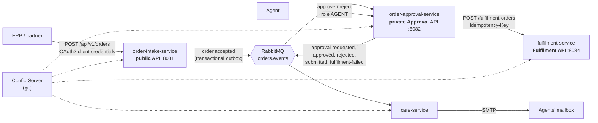

# Melita Order Platform

An authenticated **Order Taking API** for third parties (for example an ERP selling Melita products), and an
**Order Approval** workflow behind it:

- orders are validated, accepted and published as an event to RabbitMQ;
- on the **Ordering Fulfilment** side, order-approval persists each order, holds it if its products need
  approval until an agent approves it through a private API, and submits it over REST to the
  **fulfilment-service**, which creates the final fulfilment order;
- on the **Care** side, care-service emails the order to an agent.

Spring Boot 4 · Java 21 · Spring Cloud Config · Spring Security (OAuth2 / Keycloak) · Spring Data JPA ·
MySQL · RabbitMQ · Redis · SMTP · Testcontainers · Postman/Newman · Docker Compose · GitHub Actions.

The design, with its decisions and trade-offs, is in [docs/ARCHITECTURE.md](docs/ARCHITECTURE.md). The
event contract for downstream teams is in [docs/events.md](docs/events.md).

## At a glance



| Brief deliverable | Where |
|---|---|
| Authenticated public REST Order Taking API | `order-intake-service`: OAuth2 JWT, scopes, partner isolation |
| Authenticated private REST Order Approval API | `order-approval-service`: Keycloak roles `AGENT` / `SUPERVISOR` |
| Microservices with Spring Boot | Config Server, order-intake, order-approval, fulfilment, care |
| Publish / consume with RabbitMQ | Topic exchange `orders.events`, transactional outbox, idempotent consumers, DLQs |
| Emails via SMTP | `care-service` (Mailpit locally) |
| Submit the order restfully to the Ordering Fulfilment system | `order-approval-service` → `fulfilment-service` (OAuth2 client credentials, Idempotency-Key, retries, circuit breaker) |
| Orders saved with Spring Data JPA | `order-approval-service` and `fulfilment-service` (MySQL, Flyway) |
| Approval of configurable products | Approval policy in Spring Cloud Config; whole-order approval |
| Configuration in Spring Cloud Config | `config-server` serving `config-repo/` from git |
| JUnit tests and Postman collections | Unit, web-slice and Testcontainers integration tests; `postman/` run by Newman in CI |

## Run it

Prerequisites: **JDK 21** and **Docker** (with Compose v2).

```bash
cp .env.example .env
```

```bash
./mvnw -DskipTests package
```

```bash
docker compose up -d --build --wait
```

The first start pulls the images and takes a few minutes. When the command returns, everything is healthy.

| What | URL | Notes |
|---|---|---|
| Order Taking API | http://localhost:8081/swagger-ui.html | public API (partners) |
| Order Approval API | http://localhost:8082/swagger-ui.html | private API (agents) |
| Ordering Fulfilment API | http://localhost:8084/swagger-ui.html | service API (order-approval) |
| Keycloak | http://localhost:8180 | realm `melita`; admin console user `admin`, password from `.env` |
| RabbitMQ | http://localhost:15672 | user `admin`, password from `.env` |
| Mailpit (agents' mailbox) | http://localhost:8025 | every email the platform sends |

Stop with `docker compose down`, or `docker compose down -v` to also delete the data.

### Local credentials (local realm only)

These exist only in the development realm (`infra/keycloak/melita-realm.json`); none are real secrets.

| Who | How | Credentials |
|---|---|---|
| Partner `erp-partner` | client credentials | client secret `erp-partner-local-secret` |
| Partner `other-partner` | client credentials | client secret `other-partner-local-secret` |
| Agent | password grant, client `agent-console` | `agent1` / `agent1-password` |
| Supervisor | password grant, client `agent-console` | `supervisor1` / `supervisor1-password` |
| Service client `order-approval` (calls Fulfilment) | client credentials | client secret `order-approval-local-secret` |

The password grant exists only so Postman and CI can obtain agent tokens. In production, agents sign in
through a UI with authorisation code + PKCE.

### Try it with curl

The examples use `jq` to extract tokens. Get a partner token and place an order. Mobile post-paid needs an
agent's approval:

```bash
TOKEN=$(curl -s http://localhost:8180/realms/melita/protocol/openid-connect/token \
  -d grant_type=client_credentials -d client_id=erp-partner -d client_secret=erp-partner-local-secret | jq -r .access_token)
```

```bash
curl -i http://localhost:8081/api/v1/orders \
  -H "Authorization: Bearer $TOKEN" -H "Idempotency-Key: order-attempt-0001" -H 'Content-Type: application/json' \
  -d '{"externalReference":"ERP-0001",
       "customer":{"firstName":"Maria","lastName":"Borg","dateOfBirth":"1990-04-12",
         "email":"maria.borg@example.com","mobileNumber":"+35679123456",
         "identityDocument":{"type":"ID_CARD","number":"123456M"},
         "address":{"line1":"12, Triq il-Kbira","locality":"Mosta","postcode":"MST 1234"}},
       "items":[{"product":"MOBILE","packageCode":"MOBILE_POSTPAID"}]}'
```

Run the same command again: the original `201` comes back with `Idempotent-Replayed: true`, and no
second order is created.

As an agent, list orders waiting for approval and approve one:

```bash
AGENT=$(curl -s http://localhost:8180/realms/melita/protocol/openid-connect/token \
  -d grant_type=password -d client_id=agent-console -d username=agent1 -d password=agent1-password | jq -r .access_token)
```

```bash
curl -s "http://localhost:8082/api/v1/orders?status=PENDING_APPROVAL" -H "Authorization: Bearer $AGENT"
```

```bash
curl -s -X POST http://localhost:8082/api/v1/orders/<orderId>/approve -H "Authorization: Bearer $AGENT"
```

A moment later the order is `SUBMITTED` to Fulfilment, and Mailpit shows the "New order" and
"Approval needed" emails. Orders whose products need no approval go straight to Fulfilment.

### Or with Postman

Import `postman/melita-orders.postman_collection.json` with the environment
`postman/local.postman_environment.json`, and run the collection in order. Or from the command line:

```bash
npx newman@6 run postman/melita-orders.postman_collection.json -e postman/local.postman_environment.json
```

## Tests

```bash
./mvnw verify
```

Docker must be running: the integration tests start MySQL, RabbitMQ, Redis and Mailpit with Testcontainers.

| Level | What it proves |
|---|---|
| Unit | Validation rules (UTC dates from a fixed clock, working days, holidays), the order transitions no flow reaches (terminal states, approving an order that needs no approval), approval policy, request hashing, AES-GCM encryption and masking, email composition |
| Web slice (`@WebMvcTest`) | Error responses and the security matrix: 401/403 per endpoint, scope and role, 404 for another partner's order |
| Integration (Testcontainers) | Order → outbox → RabbitMQ; **parallel requests with one Idempotency-Key create one order**; replay/422/409; **duplicate delivery**; **two agents deciding at once (one 200, one 409)**; poison messages → DLQ; Fulfilment retry with the same key, permanent failure, retry exhaustion (against a scripted test fake); fulfilment-service durable idempotency and both 409 cases; encryption at rest; policy refresh; Redis down → catalogue from MySQL; SMTP down → retried, dead-lettered, marked FAILED |
| Postman + Newman | The running stack end to end with real Keycloak tokens |

Each behaviour is tested once, at the cheapest level that proves it: a rule an integration test already
exercises through the real flow has no separate unit test.

**Coding conventions** are checked by Checkstyle (`checkstyle.xml`) at the start of every module's build,
for main and test code. The build fails if a local variable or a method or constructor parameter is not
`final`, or if a declaration names more than one variable.
Classes that only hold constants or static helpers are marked with Lombok's `@UtilityClass` instead of a
hand-written private constructor; their members keep an explicit `static` so `import static` still
works. Loggers come from `@Slf4j`, never a hand-declared `Logger` field. Lombok is compile-time only and is
left out of the service jars.

CI (`.github/workflows/ci.yml`) runs `./mvnw verify`. A second job then brings up the full stack and runs
the Postman collection.

## How it works (short version)

- **Validation**, in three layers:
  - shape → 400;
  - cross-field rules → 400;
  - business rules needing the catalogue or the calendar → 422, with every violation reported at once.

  Errors are RFC 9457 problem JSON with a stable `code` and the `requestId`.
- **Idempotency.** Partners send an `Idempotency-Key`. It is enforced by a MySQL primary key in the same
  transaction as the order:
  - same key and same body → the original response is replayed;
  - same key, different body → 422;
  - an `externalReference` already used → 409.
- **Transactional outbox.** The order and its event commit together. A relay publishes the event with
  publisher confirms and clears personal data from the outbox once it is published. Consumers are
  idempotent (inbox table / unique keys), so at-least-once delivery is safe.
- **Approval.** Which products or packages need approval is configured in `config-repo/order-approval-service.yml`.
  - It is evaluated once, when the order arrives.
  - Agents approve or reject; the agent is always taken from the token.
  - The `OrderStatus` state machine and `@Version` make a second or concurrent decision a 409.
- **Fulfilment.**
  - A scheduled submitter (one active instance, chosen with a MySQL named lock) calls Fulfilment with
    OAuth2 client credentials and `Idempotency-Key = orderId`.
  - No database transaction is open during the call.
  - 5xx and timeouts are retried with exponential backoff and jitter. A 4xx fails the order.
  - A circuit breaker stops calls while Fulfilment is down, without using up retries.
- **Errors in consumers.** Poison messages go straight to the dead-letter queue. Anything else is retried
  for about a minute (enough to ride out a database restart), then dead-lettered. Dead-lettering logs the
  message ID only, never the body.
- **Caching.** The product catalogue is cached in Redis (cache-aside, 10 minutes). If Redis is down, it is
  read from MySQL.

## Security

- **Authentication.** Keycloak issues JWTs, and every service is a stateless resource server.
  - Issuer, expiry and **audience** are validated, so a token issued for one API is rejected by another.
  - Partners use client credentials with scopes; agents have realm roles.
  - Rules deny by default, and `@PreAuthorize` sits on the service methods.
- **Partner isolation.** Partner identity comes from a `partner_id` claim. Every query is scoped by it, and
  another partner's order is a 404.
- **Personal data.**
  - The identity document number is encrypted at rest (AES-256-GCM) and masked (`****56M`) in the API and
    emails. It is never logged.
  - Intake keeps only a receipt; the full order travels in the event.
- **Least privilege.**
  - one MySQL database and user per service;
  - one RabbitMQ user per service, limited to its own exchange and queues;
  - Redis behind a password;
  - containers run as a non-root user.
- **No secrets in git.** Everything sensitive comes from `.env`; `.env.example` holds local development
  values only.

## Configuration

All service configuration lives in `config-repo/` and is served by the Config Server from **git**:
- Only **committed** changes are served.
- The Config Server clones the repository, so it never touches your working tree.
- `CONFIG_GIT_LABEL` (default `main`) selects the branch, tag or commit.

To change the approval policy at runtime:
1. Edit `approval.required-packages` in `config-repo/order-approval-service.yml`.
2. Commit the change.
3. Call refresh as a supervisor:

```bash
SUPERVISOR=$(curl -s http://localhost:8180/realms/melita/protocol/openid-connect/token \
  -d grant_type=password -d client_id=agent-console -d username=supervisor1 -d password=supervisor1-password | jq -r .access_token)
```

```bash
curl -X POST http://localhost:8082/actuator/refresh -H "Authorization: Bearer $SUPERVISOR"
```

To run a service from the IDE:
1. Start the infrastructure and Config Server:

   ```bash
   docker compose up -d --wait mysql rabbitmq rabbitmq-setup redis keycloak mailpit config-server
   ```

2. Export the variables from `.env` and start the application class. Config Server is published on
   `localhost:8888`, and the shared configuration points at the infrastructure on `localhost`.

## Operations notes

- **Dead-letter queues.**
  - `order-approval.order-accepted.dlq` and `care.order-events.dlq` hold messages that could not
    be processed. The reason is in the service log, searchable by `messageId`.
  - After fixing the cause, move the messages back with the RabbitMQ UI (Queues → the DLQ → *Move
    messages*) or a shovel.
- **Failed fulfilment.** Orders in `FULFILMENT_FAILED` raise `order.fulfilment-failed` and an email to the
  agents.
- **Failed email.** A row in `notification` with status `FAILED` records an email that could not be sent.
- **Correlation.** Every response carries `X-Request-Id`. The same ID follows the order through events
  (`x-correlation-id`), the call to Fulfilment (`X-Request-Id`) and every service's logs (JSON, ECS format,
  in Docker), including the background jobs that publish events and submit orders.
- **Health.** Each service has `/actuator/health/liveness` and `/readiness`. Readiness depends on the
  database and RabbitMQ only; Redis and SMTP are optional.

## Production roadmap

Deliberately not built for this exercise:
- **Configuration and secrets:** a separate config repository and Vault for secrets.
- **Edge:** an API gateway with mTLS and per-partner rate limiting.
- **Partners:** webhooks and live order status.
- **Messaging:** Debezium CDC in place of the polling outbox relay.
- **Approval and Fulfilment:**
  - an admin API for approval rules (the other reading of "configurable products");
  - four-eyes approval;
  - a supervisor retry for failed fulfilments.
- **Email:** bounce processing (the email provider's webhook, or an IMAP adapter with Spring Integration).
- **Observability:** distributed tracing, dashboards, and alerts on DLQ depth, outbox lag and failed
  fulfilments.
- **Platform:** Kubernetes manifests.
- **SOAP:** an adapter, if the real Fulfilment system speaks SOAP (JAXB client at the edge, mapped to the
  same internal contract).

## Project layout

```
order-events-contract/     event envelope and payload records shared by producers and consumers
platform-common/           error model, request ID, security handlers, outbox/inbox, listener support
config-server/             Spring Cloud Config Server (git backend)
order-intake-service/      public Order Taking API
order-approval-service/    approval workflow, private Approval API, Fulfilment submitter
fulfilment-service/        Ordering Fulfilment API: creates the final fulfilment order
care-service/              agent emails over SMTP
config-repo/               configuration served by the Config Server
infra/                     Keycloak realm, MySQL init, RabbitMQ setup
postman/                   Postman collection and environment
docs/                      architecture and event contract
```

## How AI was used

This project was built with Claude Code, Anthropic's AI coding assistant, as a pair programmer. That's how
I work day to day.

- **Design.** I worked through the brief and the architecture with the assistant. The design choices were
  mine, and the design document was reviewed section by section before any code was written.
- **Implementation.** The assistant wrote most of the code, tests and documentation from the agreed design,
  in small commits, each with its tests.
- **Review.** I reviewed every step: the design, each change to the code and tests, and the documents. I
  am responsible for every decision in them.
