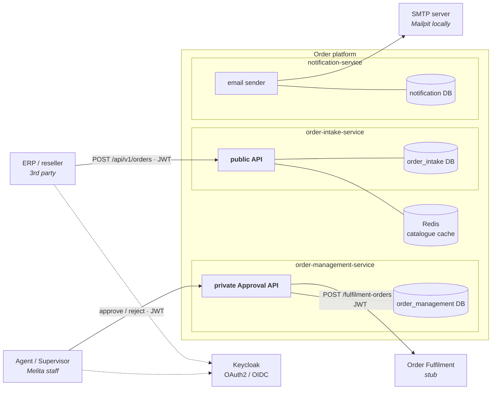
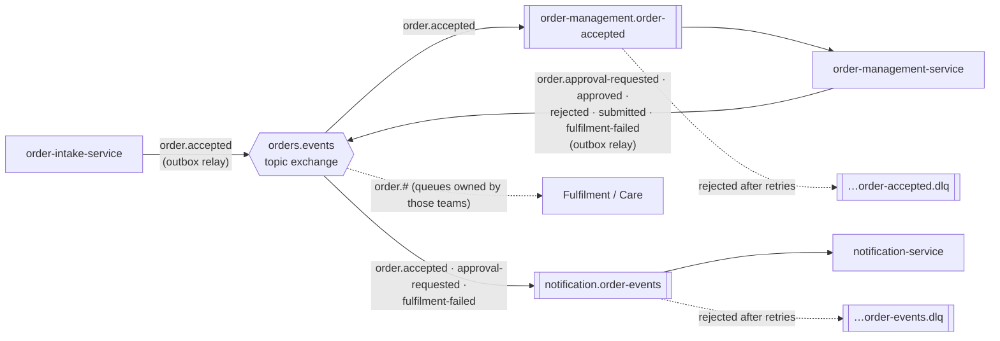
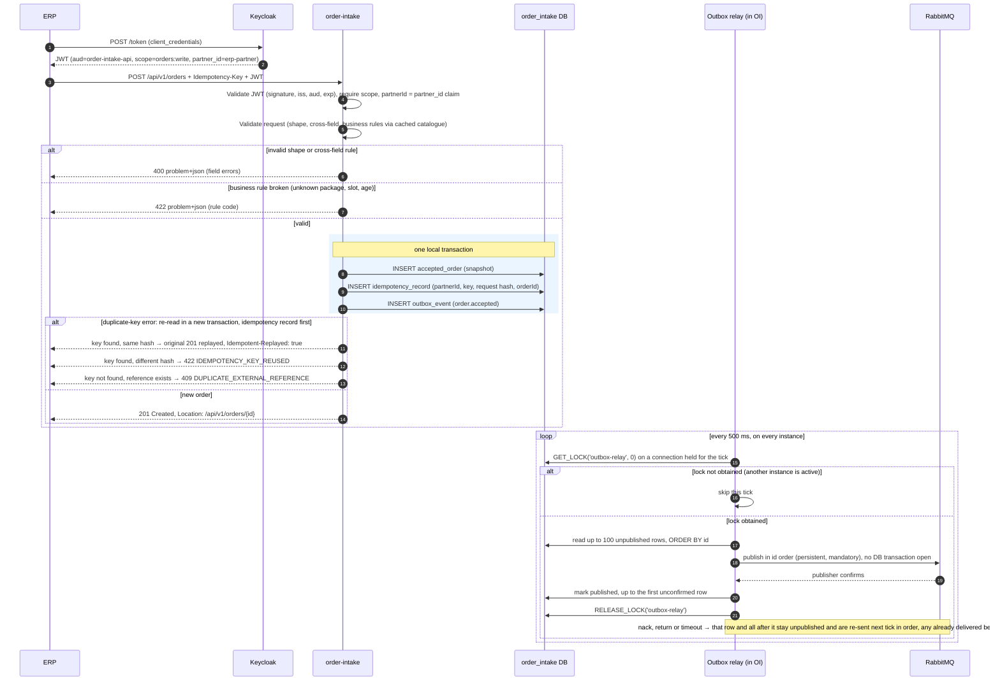
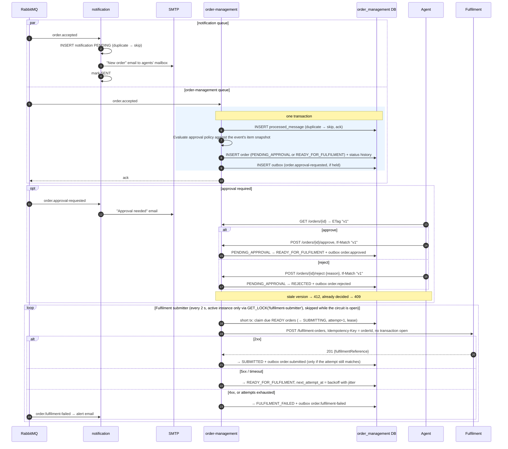
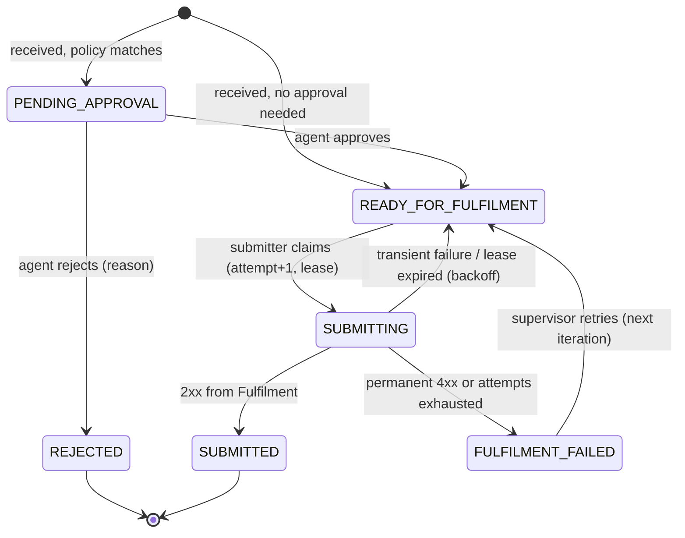

# Melita Order Taking & Approval Platform — Architecture and System Design

Status: **v1.0, approved** · Author: Supriya Thakur · Date: 2026-10-29

---

## 1. Problem statement

Third parties (for example an ERP system) sell Melita products on Melita's behalf. They need an
**authenticated public REST API** to place orders. An order carries:

- customer personal details,
- installation address, preferred installation date and time slot,
- one or more products (Internet, TV, Telephony, Mobile), each with exactly one package
  (Internet 250Mbps / 1Gbps, TV 90 / 140 channels, Telephony Free On-net / Unlimited, Mobile Prepaid / Post-paid).

The API validates and accepts the order, then publishes an event so that Melita's **Order Fulfilment** and
**Care** systems can pick it up (Task 1).

Consumers of that event must (Task 2):

1. email the order information to an agent (SMTP),
2. persist the order in a database (Spring Data JPA),
3. submit the order RESTfully to the Order Fulfilment system,
4. hold orders containing **configurable products** for **agent approval** — exposed through an
   **authenticated private Order Approval API** — before submitting them to Fulfilment.

## 2. Assumptions

### 2.1 Non-functional targets (assumed)

| Quality | Target | Consequence for the design |
|---|---|---|
| Volume | ~5,000 orders/day, peaks of ~20 requests/s on the public API | One MySQL server and single-node RabbitMQ/Redis are enough. Nothing here needs sharding or Kafka-level throughput. |
| Latency | `POST /orders` p95 < 500 ms | Intake does validation and one local transaction only, with no synchronous downstream calls. |
| Availability | Intake keeps accepting orders while order-management, Fulfilment or SMTP are down | Asynchronous hand-off through the outbox and broker. Intake has no runtime dependency on other business services. |
| Durability | An order answered with `201` is never lost | `201` is returned only after the order and its outbox event commit in the same transaction. |
| Scalability | Every service can run ≥ 2 instances | Stateless services. The outbox relay and Fulfilment submitter run on one active instance at a time, elected with a MySQL named lock; the others stand by and take over immediately (§10.4). |
| Security | Partner data isolation, least privilege, no secrets in git | §11 |

### 2.2 Functional assumptions

| # | Assumption |
|---|---|
| A1 | Callers of the public API are trusted B2B partners, onboarded by Melita, authenticating machine-to-machine (no end-customer login). |
| A2 | An order has 1–4 items, **at most one package per product type** (no two Internet lines in one order). |
| A3 | The customer **always** has a residential address (billing/contact). **Installation details (date, slot, and address) are required only if at least one product needs a technician visit** (Internet, TV, Telephony). The installation address defaults to the customer address with `installation.useCustomerAddress: true`; otherwise it is given explicitly. A Mobile-only order has no installation block. |
| A4 | Pricing, discounts, contracts and payment are out of scope — the partner has already sold the order. |
| A5 | The preferred date + slot is a *preference*. Capacity planning belongs to Fulfilment, which confirms the actual appointment. Intake only enforces rules (fixed slots, lead time, horizon, no Sundays/public holidays). |
| A6 | Customers are Maltese residents: Maltese postcode format (`ABC 1234`), phone numbers in E.164, minimum age 18. An **identity document is mandatory** (ID card or passport), since SIM registration and telecoms KYC require it. |
| A7 | "Configurable products need approval" means: **which products/packages need approval is configurable** (e.g. Mobile Post-paid, Internet 1Gbps), not that the products themselves are configurable. |
| A8 | Approval is for the **whole order** (decided). A rejection needs a reason and is final. |
| A9 | The Fulfilment system's REST contract is unknown, so we define one and provide a stub that honours an `Idempotency-Key` header. |
| A10 | The "agent" receiving the order email is a shared agents' mailbox (configurable), not a particular person. |
| A11 | Care consumes the same event stream as Fulfilment. Downstream teams own their own queues and bind them to our exchange. |

## 3. Technology choices

| Concern | Choice | Notes |
|---|---|---|
| Language / runtime | Java 21 (LTS), virtual threads on (`spring.threads.virtual.enabled=true`) | Blocking I/O workload; Spring MVC on virtual threads, no WebFlux. Java 25 (LTS) is a drop-in upgrade with Boot 4; it also removes virtual-thread pinning in `synchronized` blocks |
| Framework | **Spring Boot 4.0.9**, **Spring Cloud 2025.1.4** | Latest stable pair (Spring Cloud 2026.0 is still RC and targets Boot 4.1) |
| Build | Maven multi-module, Maven Wrapper | |
| Database | MySQL 8.4 LTS, Flyway, `ddl-auto=validate` | **Database per service**: each service has its own database and DB user |
| Messaging | RabbitMQ 4.x (Spring AMQP) | Quorum queues, publisher confirms |
| Cache | Redis 7 (Spring Cache + Spring Data Redis) | |
| Identity | Keycloak 26 (realm imported on startup) | OAuth2/OIDC issuer; services are resource servers |
| Email | Spring Mail + Thymeleaf; **Mailpit** as local SMTP server with web UI | |
| Resilience | Spring Cloud CircuitBreaker (Resilience4j); persisted retry scheduling | |
| API docs | springdoc-openapi + Swagger UI | |
| Tests | JUnit 5, AssertJ, Mockito, Spring Boot test slices, spring-security-test, Testcontainers (MySQL, RabbitMQ, Redis, Mailpit), WireMock | |
| Integration tests (black box) | Postman collection + environment, run headless by Newman | |

## 4. Architecture overview

### 4.1 Context and containers

Synchronous calls only (HTTP and database). Messaging is shown separately in the next diagram so the two
don't tangle.



Dotted arrows are token requests: client credentials for the ERP, authorisation code with PKCE for agents.

Every service also loads its configuration from the **Config Server** (git backend) at startup and on Bus
refresh. That arrow is omitted above for readability.

### 4.2 Event flow



### 4.3 Services and responsibilities

| Service | Owns | Exposes | Consumes | Publishes |
|---|---|---|---|---|
| **config-server** | `config-repo/` (git) | `/{app}/{profile}` (HTTP Basic, internal only) | — | Bus refresh events |
| **order-intake-service** | Product catalogue, accepted order receipts, idempotency records, outbox | **Public** `/api/v1/orders`, `/api/v1/catalogue` | (next iteration) order status events, to update the partner-facing status | `order.accepted` |
| **order-management-service** | The order aggregate and its lifecycle, approval decisions, Fulfilment submission, outbox, inbox | **Private** `/api/v1/orders` (agent views), `/approve`, `/reject` | `order.accepted` | `order.approval-requested`, `order.approved`, `order.rejected`, `order.submitted`, `order.fulfilment-failed` |
| **notification-service** | Email templates, notification log (dedupe + delivery status) | Actuator only | `order.accepted`, `order.approval-requested`, `order.fulfilment-failed` | — |
| **fulfilment-stub** | In-memory fulfilment orders | `/api/v1/fulfilment-orders` (JWT scope `fulfilment:submit`) | — | — |

**Why three services?**
- **Intake** is the internet-facing edge. It must stay small, hardened and available even when everything
  behind it is slow. It makes no synchronous call to another business service; its only runtime
  dependencies are its own database, Keycloak's public keys (cached) and Redis (optional).
- **Order management** is the system of record for an order's lifecycle (approval, Fulfilment hand-off).
- **Notification** is a separate failure domain: an SMTP outage must not block persistence or
  Fulfilment, and email is at-least-once by nature.

**Config Server availability.** Services fetch configuration at startup (`fail-fast` with retry) and keep
it in memory. A Config Server outage therefore blocks only *new* instances from starting; running
services are unaffected.

**Rejected alternatives:**
- A modular monolith: for a greenfield system of this size, it would be my default, with the same package
  boundaries and split later. The requirement is for microservices, so the boundaries are drawn
  where a split pays off: different exposure (public vs private), different failure domains (SMTP) and
  different owners of state.
- A separate approval service coordinated by saga: more distributed state than the problem needs.
- An API gateway in front: one public service doesn't need one; it is listed as a production next step.

### 4.4 Repository layout

```
Melita/
├── pom.xml                         (parent: dependency + plugin management)
├── order-events-contract/          (event records + routing keys only; no logic)
├── platform-web/                   (auto-configuration: RFC 9457 error model, request-ID filter, JWT 401/403 problem handlers, audience validator, PII field encryption and masking)
├── platform-messaging/             (auto-configuration: outbox entity/relay, inbox, correlation-ID propagation over AMQP; used by both order services)
├── config-server/
├── order-intake-service/
├── order-management-service/
├── notification-service/
├── fulfilment-stub/
├── config-repo/                    (Spring Cloud Config source: application.yml, <service>.yml, <service>-docker.yml)
├── infra/keycloak/melita-realm.json, infra/mysql/init.sql
├── postman/                        (collection + local/docker environments)
├── docs/ARCHITECTURE.md, docs/adr/
├── docker-compose.yml, .env.example
└── .github/workflows/ci.yml
```

The shared modules are deliberately thin:
- `order-events-contract` is the published-language contract: versioned records only.
- `platform-web` and `platform-messaging` are infrastructure code, packaged as Spring Boot
  auto-configurations (an in-house starter, `@AutoConfiguration` + `AutoConfiguration.imports`). Each bean
  is `@ConditionalOnMissingBean`, so a service can override it.
- Each service still owns its own `SecurityFilterChain` and URL rules. The shared module provides only the
  error handling and token validation pieces, so security policy stays visible in the service that applies it.

Domain code is never shared between services. Sharing a library version is acceptable in one repository.
If the services moved to separate repos, these modules would be versioned and published like any other
dependency.

## 5. End-to-end flows

### 5.1 Place order



- Validation runs **before** the transaction, so invalid requests never take a DB connection from the pool.
- The `201` is sent only after the commit, so an acknowledged order always has its event in the outbox.
- The concurrent-duplicate case is covered in §10.4.

### 5.2 Process order



- **Circuit breaker and retry budget.** While the Fulfilment circuit is open, the submitter claims
  nothing, so an outage does not burn retry attempts and push orders into `FULFILMENT_FAILED`. Orders wait
  in `READY_FOR_FULFILMENT` and are submitted when the circuit closes (half-open probe).
- **Unknown outcome.** On a timeout the order is retried with the same `Idempotency-Key`, so if the first
  call did reach Fulfilment the retry returns the same `fulfilmentReference` instead of creating a second
  order.
- **Latency.** An order that needs no approval reaches Fulfilment within about one polling interval (≤ 2 s).
  An after-commit trigger could remove that delay; polling is kept because it also recovers after a crash.

## 6. Patterns used (and why)

| Pattern | Where | Why |
|---|---|---|
| **Transactional Outbox** | Intake and management publish only through `outbox_event` | Guarantees "order saved ⇔ event published" without 2PC. A crash between commit and publish just delays the event. |
| **Polling Publisher** | Outbox relay | Reads unpublished rows in commit order and publishes them. No DB transaction is held during the broker round-trip. |
| **Leader election (single active scheduler)** with a MySQL named lock | Outbox relay, Fulfilment submitter | One instance does the work and the rest stand by. Events are published in commit order. No lease bookkeeping is needed for the relay, and failover is immediate when an instance dies. |
| **Publisher Confirms + mandatory flag** | Relay | An event is marked published only when the broker has accepted *and routed* it. |
| **Idempotency Key** | Inbound: `POST /orders`. Outbound: our calls to Fulfilment (`Idempotency-Key = orderId`) | Callers retry on timeouts. Same key + same body replays the stored response; same key + different body is rejected. Outbound, it makes retrying an unknown outcome safe. |
| **Idempotent Receiver / Inbox** | Management consumer (`processed_message`), notification (`notification` UNIQUE(`event_id`, `template`)) | RabbitMQ is at-least-once, so duplicate deliveries must have no extra effect. |
| **Publish–Subscribe Channel** (topic exchange) | `orders.events` | Fulfilment, Care, management and notification each get their own copy, and new consumers don't change the producer. |
| **Competing Consumers** | Several instances of a service on the same queue | Scales consumption out. This is safe because every consumer is idempotent and none depends on message order. |
| **Event-Carried State Transfer** | `order.accepted` carries the full validated order, including item snapshots | Consumers need no call back to intake. order-management evaluates approval from the event alone. |
| **Dead Letter Channel** | Every consumer queue has a DLX → `<queue>.dlq` | Poison or exhausted messages are parked, not lost and not blocking the queue. |
| **Retry with exponential backoff + jitter**, error classification | Consumers (bounded, in-process); Fulfilment submitter (persisted `next_attempt_at`) | Transient errors are retried; permanent ones (bad payload, 4xx) fail fast. |
| **Circuit Breaker** | Fulfilment client and submitter | Stops hammering a failing Fulfilment system. While it is open the submitter claims nothing, so retry attempts are not burned; orders stay `READY` until it recovers. |
| **State Machine** (whitelisted transitions) | `CustomerOrder.transitionTo(...)` | Illegal moves (e.g. approving a rejected order) become a 409, never a silent overwrite. |
| **Optimistic Locking + conditional updates / fencing** | `@Version` on the order; submitter updates `where status='SUBMITTING' and submission_attempt=:claimed` | Two agents approving at once: one wins, the other gets 409/412. A submitter whose lease expired cannot overwrite a newer attempt. |
| **Message Translator / Anti-corruption layer** | API DTO → domain → event contract → Fulfilment DTO, each mapped at the edge | The public contract, internal model and partner contracts evolve independently. |
| **Correlation Identifier** | `X-Request-Id` → MDC → AMQP header → outbound HTTP header | A single ID traces one order across every service and log line. |
| **Cache-Aside** | Product catalogue in Redis (intake) | Read on every order and rarely changed. Redis failure falls back to the DB. |
| **Externalized Configuration** | Spring Cloud Config, refreshed through Spring Cloud Bus | The approval policy and slot rules change without a redeploy. |

## 7. Domain model

### 7.1 Order request (public API contract)

```json
{
  "externalReference": "ERP-2026-000123",
  "customer": {
    "firstName": "Maria", "lastName": "Borg",
    "dateOfBirth": "1990-04-12",
    "email": "maria.borg@example.com",
    "mobileNumber": "+35679123456",
    "identityDocument": { "type": "ID_CARD", "number": "123456M" },
    "address": { "line1": "12, Triq il-Kbira", "line2": null, "locality": "Mosta", "postcode": "MST 1234" }
  },
  "installation": {
    "useCustomerAddress": true,
    "address": null,
    "preferredDate": "2026-11-09",
    "timeSlot": "MORNING"
  },
  "items": [
    { "product": "INTERNET", "packageCode": "INTERNET_1GBPS" },
    { "product": "TV", "packageCode": "TV_140_CHANNELS" },
    { "product": "MOBILE", "packageCode": "MOBILE_POSTPAID" }
  ]
}
```

| Field | Rule |
|---|---|
| `externalReference` | Required, 1–64 characters, `[A-Za-z0-9._-]` (the partner's own order ID); unique per partner |
| `firstName`, `lastName` | Required, 1–100 characters, Unicode letters, spaces, apostrophes and hyphens (accepts Maltese `ċ ġ ħ ż`) |
| `dateOfBirth` | Required, past date |
| `email` | Required, valid address, ≤ 254 characters |
| `mobileNumber` | Required, E.164 (`^\+[1-9]\d{7,14}$`) |
| `identityDocument` | Required. `ID_CARD`: Maltese format `^\d{1,7}[MGAPLHBZ]$`; `PASSPORT`: 6–20 alphanumerics |
| `address` | `line1` and `locality` required (≤ 100 characters); `postcode` matches `^[A-Z]{3}\s?\d{4}$` |
| `installation` | Required if any product needs a technician visit (§7.2); `timeSlot` is one of the configured slots |
| `items` | 1–4 items; `product` is an enum; `packageCode` is a catalogue code |

### 7.2 Validation layers

1. **Syntax / shape:** Bean Validation on DTO records.
   - `@NotBlank`, `@Size`, `@Email`, `@Pattern` (E.164, Maltese postcode), `@Past`.
   - `@Size(min=1,max=4)` on items; `@Valid` cascading.
   - Request body size limit; unknown JSON properties rejected (`FAIL_ON_UNKNOWN_PROPERTIES`) so typos don't silently drop fields.
2. **Cross-field (class-level validators):**
   - no duplicate product types;
   - `installation.address` present ⇔ `useCustomerAddress` is false.
3. **Business rules (domain service, using the catalogue and configured rules):**

   | Rule | Error code |
   |---|---|
   | Package exists and is active | `UNKNOWN_PACKAGE`, `PACKAGE_NOT_AVAILABLE` |
   | Package belongs to the stated product | `PACKAGE_PRODUCT_MISMATCH` |
   | Installation present ⇔ an item needs a technician visit (the catalogue's `requires_installation`) | `INSTALLATION_REQUIRED`, `INSTALLATION_NOT_APPLICABLE` |
   | Customer is ≥ 18 | `CUSTOMER_UNDERAGE` |
   | `preferredDate` ≥ `slots.min-lead-working-days` ahead | `INSTALLATION_DATE_TOO_EARLY` |
   | `preferredDate` ≤ `slots.max-horizon-days` ahead | `INSTALLATION_DATE_TOO_LATE` |
   | Not on an excluded day (Sundays, configured public holidays) | `INSTALLATION_DATE_UNAVAILABLE` |

- Failures from layers 1 and 2 → **400** with field errors. Failures from layer 3 → **422** (well-formed but
  unprocessable).
- **All violations are reported together**, each with its code and field, so a partner can fix everything
  in one round-trip.
- **Time zone:** "today", working days and age are computed in **Europe/Malta**, from an injected `Clock`.
  - An order at 00:30 Malta time is not judged against yesterday's UTC date.
  - Tests fix the clock, so the date rules are deterministic.

### 7.3 Order lifecycle (order-management)



- Transitions live in one `OrderStatus` enum with an allowed-transitions map.
- The aggregate method `transitionTo(target, actor, reason)` is the only way to change status.
- Each transition writes an `order_status_history` row: who, when, why.
- **Approval after the preferred date has passed.** An order can wait in `PENDING_APPROVAL` past its
  preferred installation date, or into the minimum lead time.
  - Approval still goes ahead, and the Fulfilment request carries `preferredSlotExpired: true`.
  - Fulfilment owns scheduling (A5), so it arranges a new appointment with the customer.
  - The order detail shows the agent a warning before they approve.
  - Slow approvals surface through the `approvals.pending.oldest.seconds` gauge (§14).

### 7.4 Approval policy

`order-management.yml` in the config repo:

```yaml
approval:
  required-packages: [MOBILE_POSTPAID, INTERNET_1GBPS]
  required-products: []          # e.g. [TV] to require approval for any TV package
```

- It is bound to a validated `@ConfigurationProperties` record.
- It matches the package and product codes carried in the event's item snapshot, so order-management
  needs no catalogue of its own (event-carried state transfer).
- It is evaluated **once, when the order is received**. The matched rules are stored on the order
  (`approval_reasons`), so a later policy change never re-classifies orders already in flight, and the
  agent can see *why* the order is held.
- It is refreshed at runtime: commit to the config repo, then call `POST /actuator/busrefresh` on the
  Config Server. Spring Cloud Bus broadcasts the refresh over RabbitMQ.
  - An immutable `@ConfigurationProperties` **record is not rebound on refresh**, so the policy would
    silently stay the same. The record is therefore only the binding.
  - The `ApprovalPolicy` bean used by the domain is built from it and marked `@RefreshScope`, so it is
    recreated after a refresh.
  - An integration test changes the property, triggers a refresh and asserts that the next order is
    evaluated with the new policy.

## 8. API design

All error responses are `application/problem+json` (RFC 9457). Example:

```json
{
  "type": "https://api.melita.example/problems/validation-error",
  "title": "Request validation failed",
  "status": 400,
  "detail": "2 fields are invalid",
  "instance": "/api/v1/orders",
  "code": "VALIDATION_FAILED",
  "requestId": "6f1c…",
  "errors": [ { "field": "customer.mobileNumber", "message": "must be in E.164 format" } ]
}
```

Responses never include stack traces or internal exception messages.

**Conventions (both APIs)**
- **Versioning:** in the URI (`/api/v1`). Within a version, changes are additive only, and clients must
  ignore unknown fields. A breaking change means `/api/v2`. Removal is announced with `Deprecation` and
  `Sunset` headers.
- **JSON:** camelCase fields, ISO-8601 dates (`2026-11-09`) and UTC instants (`2026-10-29T10:15:30Z`).
  Absent optional fields are omitted, not sent as `null`.
- **Pagination:** `page`, `size` (default 20, max 100) and `sort` (allow-listed fields only).
  - The response shape is stable: `{ "content": [...], "page": { "number", "size", "totalElements", "totalPages" } }`,
    Spring Data's `PagedModel`, not a serialised `Page`.
- **Headers:** every response carries `X-Request-Id`. A `Retry-After` header accompanies a 503 (and a 429,
  once rate limiting is added).
- **Documentation:** OpenAPI 3.1 at `/v3/api-docs` and Swagger UI at `/swagger-ui.html`, generated from the
  code, so docs and code cannot drift. The private API's docs are behind authentication.

### 8.1 Public Order Taking API (order-intake, port 8081)

| Method | Path | Auth | Success | Errors |
|---|---|---|---|---|
| POST | `/api/v1/orders` | scope `orders:write`, header **`Idempotency-Key`** (required, 8–64 chars) | **201** + `Location` + `{orderId, externalReference, status: ACCEPTED, acceptedAt}`; a replay returns the original 201 response with `Idempotent-Replayed: true` | 400 validation, 401, 403, 409 `DUPLICATE_EXTERNAL_REFERENCE` (same reference, different key; the body includes `existingOrderId`), 422 `IDEMPOTENCY_KEY_REUSED` (key reused with a different body, as in the IETF Idempotency-Key draft), 413, 415, 422 business rule |
| GET | `/api/v1/orders/{orderId}` | scope `orders:read`, **own orders only** | 200 receipt: the accepted order and `status: ACCEPTED`. Live processing status is planned for the next iteration (§16). | 404 (also returned for another partner's order, so we don't leak existence) |
| GET | `/api/v1/catalogue/products` | scope `orders:read` | 200 active products + packages + `requiresInstallation` | 401, 403 |

### 8.2 Private Order Approval API (order-management, port 8082)

| Method | Path | Auth | Success | Errors |
|---|---|---|---|---|
| GET | `/api/v1/orders?status=PENDING_APPROVAL&page=0&size=20&sort=receivedAt,asc` | role `AGENT` or `SUPERVISOR` | 200 page of summaries (projection) | 400, 401, 403 |
| GET | `/api/v1/orders/{id}` | `AGENT` / `SUPERVISOR` | 200 detail + `ETag: "<version>"` | 404 |
| POST | `/api/v1/orders/{id}/approve` `{ "comment": "…" }` (optional, ≤ 500 characters) | `AGENT` / `SUPERVISOR`, `If-Match` required | 200 updated order + new ETag; includes `warnings: ["PREFERRED_SLOT_EXPIRED"]` when applicable | 404, 409 `INVALID_STATE_TRANSITION`, 412 stale version, 428 missing If-Match |
| POST | `/api/v1/orders/{id}/reject` `{ "reason": "…" }` (required, 10–500 characters) | `AGENT` / `SUPERVISOR`, `If-Match` required | 200 updated order + new ETag | as above, 400 missing or invalid reason |
| POST | `/api/v1/orders/{id}/fulfilment-retry` *(next iteration)* | `SUPERVISOR` | 202 | 409 unless `FULFILMENT_FAILED` |
| GET | `/api/v1/approval-policy` | `SUPERVISOR` | 200 current policy | |

The deciding agent is taken from the JWT (`sub`, `preferred_username`), **never from the request body**, and stored for audit.

### 8.3 Fulfilment contract (stub, port 8084)

```
POST /api/v1/fulfilment-orders
Authorization: Bearer <client-credentials JWT, aud=fulfilment-api, scope fulfilment:submit>
Idempotency-Key: <orderId>
X-Request-Id: <correlation id>

{ "orderId": "…", "externalReference": "…", "partnerId": "…",
  "customer": { … }, "installation": { …, "preferredSlotExpired": false } | null,
  "items": [ { "product": "INTERNET", "packageCode": "INTERNET_1GBPS" } ] }
```

| Response | Meaning | Submitter outcome (§5.2) |
|---|---|---|
| 201 `{ "fulfilmentReference": "FUL-…", "status": "SCHEDULED" }` | Created | `SUBMITTED` |
| 200, same body | Replay of an `Idempotency-Key` already processed | `SUBMITTED` (the unknown-outcome case resolved) |
| 400 / 422 | Request rejected by Fulfilment | `FULFILMENT_FAILED`, not retried |
| 401 / 403 | Our credentials are wrong | `FULFILMENT_FAILED` + alert (configuration problem; retrying will not help) |
| 409 | Same key, different body | `FULFILMENT_FAILED` + alert (should never happen; indicates a bug) |
| 429 / 5xx / timeout | Temporary | Retry with backoff; counts towards the circuit breaker |

The stub has a failure-injection switch (`stub.failure-rate`, `stub.latency`) so retries and the circuit
breaker can be exercised in tests and locally.

## 9. Messaging design

### 9.1 Topology (declared in code with Spring AMQP `Declarables`)

| Exchange (type) | Routing keys | Bound queues |
|---|---|---|
| `orders.events` (topic, durable) | `order.accepted`, `order.approval-requested`, `order.approved`, `order.rejected`, `order.submitted`, `order.fulfilment-failed` | `order-management.order-accepted` ← `order.accepted`; `notification.order-events` ← `order.accepted`, `order.approval-requested`, `order.fulfilment-failed` |
| `orders.events.dlx` (direct, durable) | the queue's own name, set with `x-dead-letter-routing-key` | `order-management.order-accepted.dlq`, `notification.order-events.dlq` |

- **Ownership.** Producers declare the exchange; each consumer declares its own queue, bindings and DLQ.
  Declarations are idempotent, so start-up order does not matter.
- **Queue arguments.** All queues are **quorum queues** (replicated, durable), with:
  - `x-dead-letter-exchange: orders.events.dlx` and an explicit `x-dead-letter-routing-key`. Without the
    routing key, dead-lettered messages keep their original key and match no DLQ binding.
  - `x-dead-letter-strategy: at-least-once` with `x-overflow: reject-publish`. Quorum queues dead-letter
    **at-most-once by default**, which could lose a message on its way to the DLQ.
  - `x-delivery-limit: 20` as a backstop against redelivery loops; retries normally happen in-process (§9.4).
- **External consumers.** Fulfilment and Care declare their own queues bound to `orders.events`, e.g.
  `care.order-events` ← `order.#`. The event contract (§9.2) is the interface; it is documented in
  `docs/events.md` with a JSON example per event type.
- **Config refresh.** The `springCloudBus` exchange is created by Spring Cloud Bus.

### 9.2 Event envelope

```json
{
  "eventId": "0192f…(UUIDv7)",
  "eventType": "order.accepted",
  "schemaVersion": 1,
  "occurredAt": "2026-10-29T10:15:30Z",
  "correlationId": "6f1c…",
  "source": "order-intake-service",
  "data": { "orderId": "…", "partnerId": "erp-partner", "externalReference": "…", "customer": {…}, "installation": {…}, "items": [ … ] }
}
```

| Event | Producer | `data` | PII |
|---|---|---|---|
| `order.accepted` | intake | Full validated order: `orderId`, `partnerId`, `externalReference`, `customer` (incl. address and ID document), `installation`, `items[]` with `product`, `packageCode`, `packageName`, `acceptedAt` | **Yes**, needed by Fulfilment and Care |
| `order.approval-requested` | management | `orderId`, `externalReference`, `approvalReasons[]`, `items[]` (codes and names) | No |
| `order.approved` | management | `orderId`, `externalReference`, `decidedBy`, `decidedAt`, `comment`, `preferredSlotExpired` | No |
| `order.rejected` | management | `orderId`, `externalReference`, `decidedBy`, `decidedAt`, `reason` | No |
| `order.submitted` | management | `orderId`, `externalReference`, `fulfilmentReference`, `submittedAt` | No |
| `order.fulfilment-failed` | management | `orderId`, `externalReference`, `attempts`, `lastError` (code and short message, no response body) | No |

Only `order.accepted` carries personal data, and it carries the ID document number **in plaintext**:
- Fulfilment and Care need the real value;
- sharing our encryption keys with them would widen exposure, not reduce it.

In transit it is protected by TLS to the broker (production), and the broker's queues are access-controlled per consumer.

Later events reference the order by ID, so consumers that
need details look them up in their own copy.

- AMQP properties carry the same metadata: `message_id = eventId`, `type = eventType`,
  `content_type = application/json`, `delivery_mode = persistent`, header `x-correlation-id`.
- **Schema evolution:** additive changes only within a version; consumers ignore unknown fields;
  a breaking change gets a new `schemaVersion` and both versions are published during migration.

### 9.3 Delivery guarantees

| Step | Guarantee | How |
|---|---|---|
| DB commit → broker | At-least-once | Outbox + relay. A row is marked published only after the confirm. A crash after the publish but before the mark → re-published → consumers dedupe. |
| Broker → consumer | At-least-once | Container-managed ack (`AcknowledgeMode.AUTO`): acked only after the listener returns successfully, rejected on exception; prefetch 10, 2–4 consumers per instance. |
| Consumer side effect | Effectively-once (management); at-least-once (email) | Inbox row written in the same transaction as the side effect (management). The inbox is checked first; if two instances race on the same message, the loser's unique-key violation is treated as a duplicate and acked. A notification row is claimed as `PENDING` before sending and marked `SENT` after (notification). |
| Ordering | Best effort: one active relay publishes in commit order and stops a batch at the first failure | Order can still break in rare cases: consumer retries, competing consumers, or a brief split brain during relay failover (§10.4). So consumers still do not depend on it. Management is the only consumer that changes state, and it reacts to a single event type. Notification treats each event as independent. |

**Known edge case:** notification may send a duplicate email if it crashes *after* the SMTP send but *before*
the row is marked `SENT`. On redelivery a `PENDING` row is sent again. This is accepted (email is
at-least-once by nature) and documented.

### 9.4 Consumer error handling

Errors are classified, because the right reaction differs:

| Class | Examples | Handling |
|---|---|---|
| **Poison** (the message can never succeed) | `MessageConversionException`, payload validation failure, unknown `schemaVersion`, template bug | No retry. Straight to the DLQ via a `ConditionalRejectingErrorHandler` with a custom `FatalExceptionStrategy` |
| **Infrastructure unavailable** (affects every message) | DB down (`CannotCreateTransactionException`, `TransientDataAccessResourceException`), SMTP connection refused or `421` | **Retry without limit**, exponential backoff with jitter, capped at 60 s. The message stays at the head of the queue; nothing is dead-lettered during an outage. Readiness reports DOWN. Queue depth is the back-pressure signal. |
| **Other / message-specific** | Recipient-specific SMTP 4xx (`450`, `452`), unexpected exceptions | `RetryInterceptor`: 4 attempts, 1 s → 2 s → 4 s with jitter, then `RejectAndDontRequeueRecoverer` → DLX → `.dlq` |

- Without the infrastructure class, a 30-second MySQL restart would dead-letter every order received
  during it, each needing a manual replay.
- In-process retry holds one consumer thread while it waits. During an infrastructure outage that is the
  intent: consumption pauses instead of churning. The production alternative for message-specific retries
  is delayed retry queues (per-attempt TTL), documented in the README.
- DLQ depth is exposed as a metric; alerting on it is a production next step. Messages are replayed with
  the RabbitMQ shovel or the management UI (runbook in the README).

### 9.5 Email delivery and bounces

Email is a **notification, never the source of truth**:
- an order awaiting approval is always visible in the Approval API's pending list, whether or not the email arrived;
- order processing never waits for, or depends on, email.

**Notification log.** Each email gets a row in `notification`:
- status `PENDING → SENT | FAILED | BOUNCED`;
- UNIQUE(`event_id`, `template`), which is also the consumer's dedupe;
- attempts, `last_error`, `smtp_message_id`.

**Send-time failures** (the SMTP server refuses the email) are classified from the `MailSendException` and the SMTP reply code:

| Failure | Examples | Handling |
|---|---|---|
| Server unavailable | Connection refused, timeout, `421` | Infrastructure class (§9.4): retried until the SMTP server is back; nothing is lost or dead-lettered |
| Temporary, recipient-specific | `450`, `451`, `452` | Bounded retry (§9.4). Once exhausted → message to DLQ, row stays `PENDING` with `last_error`, alert |
| Permanent | 5xx (`550 mailbox unavailable`, `553 bad address`), invalid address | No retry. Row → `FAILED` with the reason, `notification.failed{reason}` metric, error log. Message acked (it is not a poison message). The recipient is our configured agents' mailbox, so a permanent failure means misconfiguration: ops fix the address in the config repo, then re-trigger with a supervisor endpoint (next iteration) or by replaying the event |
| Template / rendering error | Missing variable | Treated as a bug: no retry → DLQ |

**Late bounces** (accepted by the SMTP server, bounced later by the receiving server):
- Every email is prepared so a bounce can be matched to it:
  - envelope sender (Return-Path) `bounces+<notificationId>@melita.example` (VERP);
  - a `Message-ID` containing the notification ID.
- Processing the bounce reports is **not part of this release**. In production it is the email
  provider's bounce webhook, or a Spring Integration IMAP inbound adapter polling the bounces mailbox,
  marking the row `BOUNCED` and alerting.

**Backstop for any lost email:** the `approvals.pending.oldest.seconds` gauge, with an alert when an order
has waited longer than N hours. An optional reminder email is planned for the next iteration.

**Testing:** Mailpit's chaos mode makes SMTP reject recipients with a chosen 4xx or 5xx code. It is used in
integration tests and in a Postman scenario.

## 10. Data design

**Database per service.** Each service owns its own database (`order_intake`, `order_management`,
`notification`):
- each is reached only through that service's own DB user, whose grants cover that database alone;
- no service reads or writes another service's database. Data moves between services only through events
  and APIs.

In the local compose setup the three databases share one MySQL 8.4 server to keep the stack light. In
production each can be a separate instance or managed cluster; only the JDBC URL in the config repo
changes.

All tables use `InnoDB`, `utf8mb4` / `utf8mb4_unicode_ci`.

- **IDs:** UUIDv7 generated by the application, stored as `CHAR(36)` with `ascii_bin` collation.
  - Readable in SQL, logs and support queries, with no `BIN_TO_UUID()` needed. The cost is 36 bytes per key
    instead of 16, which is negligible at this volume.
  - `ascii_bin` keeps comparisons byte-wise and one byte per character, rather than 4 bytes per character under `utf8mb4`.
  - Time-ordered, so inserts stay append-friendly for the InnoDB clustered index.
  - Globally unique across services, so the same `orderId` is used everywhere.
- **Timestamps:** `DATETIME(6)` holding UTC. Not `TIMESTAMP`, which cannot store dates after 2038-01-19 and converts with the session time zone. The JDBC URL pins `connectionTimeZone=UTC`, and Hibernate maps `Instant` to it.
- **Enums:** stored as `VARCHAR` with a `CHECK` constraint (not MySQL `ENUM`), so adding a value is a cheap
  migration.
- **Migrations:** Flyway, forward-only (`V{n}__description.sql`). Undo migrations are a paid Flyway feature,
  so rollback is done by a new forward migration. Schema changes follow expand → migrate → contract, so the
  previous release still runs against the new schema during a rolling deploy.
- **Personal data at rest.**
  - **ID document number: encrypted at the application level** with AES-256-GCM.
    - It is encrypted by a JPA `AttributeConverter` in order-management, and by the snapshot writer for
      intake's JSON `payload`.
    - Stored as `v1:<keyId>:<base64(iv | ciphertext | tag)>`. A random 96-bit IV is used per value.
    - Keys come from the environment (`PII_KEYS`, `PII_ACTIVE_KEY_ID`), and **each service has its own
      key**. The key ID in every value allows rotation: new writes use the active key, and old values stay
      readable until re-encrypted.
    - The value is not searchable, and nothing needs to search it.
  - **Masking:**
    - the ID number appears as `****56M` in the Approval API, in emails and in `toString()`;
    - it is never logged.
    - The Approval API returns masked values only; no endpoint returns the clear number.
  - **Other personal fields** (name, date of birth, email, phone, address) rely on storage encryption at
    rest (MySQL/InnoDB tablespace encryption or encrypted volumes in production) and least-privilege DB
    users. Encrypting them would make agent search and support queries impossible for little gain.

### 10.1 `order_intake` database

| Table | Key columns / constraints | Indexes (why) |
|---|---|---|
| `product` | `code` PK, `name`, `requires_installation`, `active` | — |
| `product_package` | `code` PK, `product_code` FK → product, `name`, `active` | FK index (catalogue join) |
| `accepted_order` | `id` PK, `partner_id`, `external_reference`, `status`, `payload JSON` (validated snapshot), `accepted_at`, **UNIQUE(`partner_id`, `external_reference`)** | the unique key is the business-duplicate check |
| `idempotency_record` | **PK(`partner_id`, `idempotency_key`)**, `request_hash CHAR(64)`, `order_id` FK → `accepted_order`, `created_at` | `created_at`: the nightly purge job deletes records older than 30 days (the replay window promised to partners) |
| `outbox_event` | `id BIGINT AUTO_INCREMENT` PK, `event_id CHAR(36)` UNIQUE, `aggregate_id`, `event_type`, `routing_key`, `payload JSON`, `headers JSON`, `created_at`, `published_at NULL`, `attempts`, `last_error` | `(published_at, id)`: the relay's "unpublished, oldest first" scan. **The relay sets `payload` to NULL when it marks a row published**, so personal data never lingers in the outbox; the metadata row is purged after 7 days |

- **Request hash.** SHA-256 of the request re-serialised canonically: the parsed DTO written with sorted
  keys and no insignificant whitespace. Formatting or key order does not count as a different body.
- **Insert order.** `accepted_order` → `idempotency_record` → `outbox_event` in one transaction, matching the
  foreign key. On any duplicate-key error the request is re-read in a new transaction:
  1. If the idempotency record exists → replay (same hash) or 422 (different hash).
  2. Otherwise, if the `externalReference` exists → 409.

  Checking the idempotency record first means a retried request is always replayed, even when its first
  collision was on the reference.
- `accepted_order.status` is always `ACCEPTED` in this release; the column is there for partner-facing
  status updates in the next iteration.

Intake stores the accepted order as a **JSON snapshot**, not a normalised model:
- intake is the receiving edge, not the order's system of record;
- the snapshot is the audit record of exactly what the partner sent.

The normalised model lives in order-management.

### 10.2 `order_management` database

| Table | Key columns / constraints | Indexes (why) |
|---|---|---|
| `customer_order` | `id` PK (= intake orderId), `partner_id`, `external_reference`, `status` (CHECK), customer columns incl. residential address (embedded `Customer` and `Address` value objects, NOT NULL), installation columns: date, slot and a resolved installation address, always stored explicitly even when it was defaulted from the customer address (nullable, CHECK: all-or-none), `approval_required`, `approval_reasons JSON`, `decided_by`, `decided_at`, `decision_reason`, `approval_comment`, `preferred_slot_expired`, `fulfilment_reference`, `submission_attempt INT`, `next_attempt_at`, `lease_until`, `version BIGINT`, `received_at`, `updated_at` | `(status, received_at)` — agent pending-approval list; `(status, next_attempt_at)` — submitter claim scan; UNIQUE(`partner_id`, `external_reference`) |
| `order_item` | `id` PK, `order_id` FK, `product_code`, `package_code`, `package_name` (snapshot from the event), `requires_approval`, **UNIQUE(`order_id`, `product_code`)** | FK index |
| `order_status_history` | `id` PK, `order_id` FK, `from_status`, `to_status`, `actor`, `reason`, `occurred_at` | `(order_id, occurred_at)` |
| `processed_message` | **PK(`message_id`, `consumer`)**, `processed_at` | `processed_at`: purged after 30 days. A later duplicate is still stopped by the `customer_order` PK |
| `outbox_event` | as in intake | as in intake |

- `EXPLAIN` output for the two hot queries (pending list, submitter claim) will be recorded in the
  migration comments.
- **N+1:** the list endpoint uses an interface projection without items; the detail endpoint fetches
  items with `@EntityGraph`.
- **Every update bumps `version`.** The submitter's conditional updates (`… set status = ?, version = version + 1
  where id = ? and status = ? and submission_attempt = ?`) bypass JPA, so they increment `version`
  themselves. That keeps ETags and optimistic locking correct for agents.

### 10.3 `notification` database

| Table | Key columns / constraints | Indexes (why) |
|---|---|---|
| `notification` | `id` PK, `event_id`, `template`, `order_id`, `recipient`, `status` (CHECK), `attempts`, `smtp_message_id`, `last_error`, `created_at`, `sent_at`, **UNIQUE(`event_id`, `template`)** | the unique key is the dedupe; `(status, created_at)` for the failed/stuck view and alerting |

### 10.4 Transactions and concurrency

- MySQL's default isolation is REPEATABLE READ. Correctness here comes from constraints, versions and
  conditional updates, not from the isolation level.
- **No remote call is made inside a DB transaction**: no HTTP, no SMTP, no broker publish.

Concurrency scenarios:

| Scenario | Outcome | Mechanism |
|---|---|---|
| Partner sends the same Idempotency-Key twice in parallel | One order. The second request replays the first response. | The second transaction's INSERT blocks on a unique key until the first commits, then fails with a duplicate-key error. It is re-read in a new transaction, idempotency record first (§10.1), and replayed (or 422 if the body differs). |
| Two agents approve and reject the same order at once | One decision wins. The other gets 412 (stale `If-Match`) or 409 (no longer pending). | `@Version` optimistic locking |
| Active submitter A loses its lock connection while still calling Fulfilment; B takes the lock and re-claims the order after its lease expires | Only the latest attempt's result is applied. Fulfilment dedupes by `Idempotency-Key`. | Update conditioned on `submission_attempt`, which acts as a fencing token |
| Same `order.accepted` delivered twice | One order | Inbox PK + `customer_order` PK |

**Single active scheduler with a MySQL named lock.** The outbox relay and the Fulfilment submitter run on
every instance, but each tick first calls `GET_LOCK('<job>', 0)`. Only the holder works; the others skip
the tick.
- **The lock is tied to the MySQL connection, not to the thread.** HikariCP hands connections between
  threads, so the job borrows **one** connection, takes the lock, does its work and releases the lock on
  that same connection, then returns it to the pool. It holds a connection but **never a transaction**
  while calling RabbitMQ or Fulfilment.
- **Failover.** If the active instance dies, its connection closes and MySQL frees the lock at once. The
  next tick on another instance takes over, with no lease to wait out (unlike a lock-table library such as
  ShedLock).
- **Split brain.** A dropped connection frees the lock while the old holder may still be mid-batch, so
  two instances can briefly work at once:
  - for the relay, that means duplicate publishes, already absorbed by idempotent consumers;
  - for the submitter, the per-order `lease_until` and the `submission_attempt` fencing token ensure only
    the latest attempt's result is applied.

  The lock gives efficiency and ordering; correctness never depends on it.
- **Recovery.** On becoming active, the submitter returns `SUBMITTING` orders whose lease has expired to
  `READY_FOR_FULFILMENT`; retrying is safe because Fulfilment dedupes by `Idempotency-Key`.

## 11. Security design

### 11.1 Identity and tokens (Keycloak realm `melita`)

| Client / user | Flow | Token claims → Spring authorities |
|---|---|---|
| `erp-partner`, `other-partner` (confidential) | client credentials | `aud=order-intake-api` (audience mapper), `scope=orders:write orders:read` → `SCOPE_orders:write`, …; **`partner_id`** (hard-coded claim mapper per client) → partnerId |
| `order-management` (confidential) | client credentials | `aud=fulfilment-api`, `scope=fulfilment:submit` (service-to-service call to Fulfilment) |
| `agent-console` (public, PKCE) | authorisation code + PKCE | `aud=order-management-api`, `realm_access.roles` → `ROLE_AGENT` / `ROLE_SUPERVISOR` |
| `agent-console-test` (**local/test realm only**) | direct access grant for the two test users | Same claims as `agent-console`. Exists only so Postman/Newman can obtain agent tokens without a browser in CI; never part of a production realm. |
| users `agent1` / `supervisor1` | — | roles `AGENT` / `SUPERVISOR`; `SUPERVISOR` is a composite role that includes `AGENT` |

- **Partner identity comes from a dedicated `partner_id` claim, not from the OAuth client ID.** A partner
  can then rotate or add clients without losing access to its orders.
- Access tokens live 5 minutes. Keycloak adds `aud` only through an audience mapper, which the realm
  export configures per client.
- Credentials for the local development realm only are in the README. No real secrets are committed;
  client secrets come from `.env`.

### 11.2 Resource servers (each service)

- `SecurityFilterChain` bean, stateless (`SessionCreationPolicy.STATELESS`).
  - CSRF disabled **because** there are no cookies or sessions.
  - CORS off; the callers are machine clients.
- JWT validation:
  - signature checked against the JWKS from `issuer-uri`;
  - `iss`, `exp` and `nbf` checked with 30s clock skew;
  - a **custom audience validator**, so a token minted for another API is rejected.
- Authorisation at two levels:
  - URL rules in the filter chain (deny by default: `anyRequest().denyAll()` after the explicit rules);
  - `@PreAuthorize` on application services (defence in depth).
- **Partner data isolation:** every intake query is scoped by `partnerId` taken from the token.
  Another partner's order → 404. Tested with two partner clients.
- **Outbound service-to-service calls:** order-management calls Fulfilment through Spring Security's
  OAuth2 client (client-credentials `OAuth2AuthorizedClientManager` with a `RestClient` interceptor). The
  token is cached and renewed before it expires.
- 401 and 403 are returned as problem JSON via a custom `AuthenticationEntryPoint` / `AccessDeniedHandler`,
  with a `WWW-Authenticate` header on 401.
- Actuator:
  - `health` and `info` are public, with health details hidden;
  - everything else is exposed only on the management port, which is not published outside the compose network.
- Config Server: HTTP Basic credentials from the environment, internal network only.
- **Least privilege for infrastructure, not just MySQL:**
  - **RabbitMQ:** one user per service, with configure/write/read permissions limited by regex.
    order-intake can only declare and publish to `orders.events`; each consumer can only read its own
    queues.
  - **Redis:** password-protected (ACL user), not published on the host.
  - **Compose:** only the APIs, Keycloak and the Mailpit UI are published on the host.
- Hardening:
  - security headers are Spring Security's defaults (HSTS when behind TLS);
  - limits on request body size and header size;
  - Jackson polymorphic (default) typing is never enabled, and Redis uses typed JSON serialisers, so
    payloads never name Java classes (a known deserialisation attack route);
  - container images run as a non-root user on a JRE-only base image;
  - dependency vulnerability scanning in CI (OWASP Dependency-Check / Dependabot);
  - no PII in logs — only orderId, externalReference and partnerId are logged; email bodies are not logged.
- **The private API is private by deployment as well as by auth.** In production it sits on the
  internal network or VPN ingress only. In the local compose setup it is published on a separate port for testing.

### 11.3 Threats considered (short STRIDE pass)

| Threat | Mitigation |
|---|---|
| Spoofed partner / stolen token | Short-lived JWTs (5 min), audience check, client secret rotation in Keycloak; mTLS at the ingress in production |
| Partner reading or overwriting another partner's orders | Partner scoping on every query, uniqueness per partner |
| Replay / duplicate submission | Idempotency key + external-reference uniqueness |
| Tampering with approval identity | Agent identity read from the JWT only; status history audit |
| Flooding the public API | Payload limits, max items; **rate limiting per partner** (Redis token bucket in the next iteration; API gateway in production) |
| Information disclosure in errors | Problem JSON with stable codes only; generic 500 with `requestId` for support |
| Elevation of privilege (partner token on the private API, agent token on the public API) | Per-API audience check, scope and role rules, deny by default |
| Repudiation of approval decisions | `order_status_history` with actor from the JWT, plus structured logs with `requestId` |
| PII at rest / in transit | ID document number encrypted per field (AES-256-GCM, per-service keys, rotation by key ID) and masked everywhere it is shown; outbox payload cleared once published; TLS everywhere in production; storage encryption at rest; least-privilege DB users |

## 12. Caching strategy

| Data | Cached? | How / why |
|---|---|---|
| Product catalogue (products + packages) | **Yes** | `@Cacheable("catalogue")`: the whole catalogue as **one entry** (small, looked up by code), typed JSON serialiser, TTL 10 min, `sync=true` against a stampede (per instance). Read on every order, changes only via migration/release. |
| Approval policy, slot rules | No (in-memory config) | Already in memory, refreshed via Bus |
| Orders, approval state | **No** | Changes fast and is the subject of concurrent updates; a stale read would cause wrong decisions |
| Security decisions / tokens | No | JWKS is cached by Spring Security itself |
| Idempotency | Not in Redis | The DB unique key is the arbiter, in the same transaction as the order; a Redis fast path adds a second source of truth for little gain at this volume |
| Notification dedupe | No, MySQL | The `notification` table is also the delivery-status record (needed for failure and bounce tracking), so dedupe belongs there |

- **Versioned keys.** Cache keys are prefixed with the application version (`oi:<version>:catalogue`).
  - A release that adds a package via migration reads its own fresh entry immediately, rather than
    rejecting the new code with 422 for up to 10 minutes.
  - Old instances keep their own entries during a rolling deploy.
- **Redis is optional.** A `CacheErrorHandler` logs and falls through to the DB when Redis is down, and
  the Redis command timeout is 200 ms, so a slow Redis cannot slow orders down. Caching is an
  optimisation, not a dependency for correctness, and readiness does not fail on Redis.

## 13. Configuration (Spring Cloud Config)

- `config-repo/` holds:
  - `application.yml` (shared: Jackson, problem details, actuator, logging pattern with `requestId`);
  - `<service>.yml`;
  - `<service>-docker.yml` (host names inside compose).
- The Config Server's git backend points at this repository with `search-paths: config-repo` and
  `default-label: main`. It serves **committed** configuration only; an uncommitted local edit is not
  picked up (README note for developers).
- Each service has only `spring.application.name` and
  `spring.config.import=configserver:${CONFIG_SERVER_URL}` locally, with `fail-fast` + retry.
- Typed `@ConfigurationProperties` records, validated with `@Validated`, so bad config fails at startup.
- **Refreshable at runtime:** the approval policy, slot rules and email recipients (`@RefreshScope` beans,
  §7.4). **Not refreshable:** datasource, broker and security settings, which need a restart.
- Services authenticate to the Config Server with HTTP Basic credentials from the environment.
- Secrets are `${ENV_VAR}` placeholders resolved in the service from the environment (`.env`, never committed).
- Tests do not need the Config Server: `spring.cloud.config.enabled=false` plus test properties. One smoke
  test boots Config Server and checks every service's config resolves.

Production note: the config repo becomes a separate, access-controlled git repo, and secrets move to
Vault (`spring-cloud-vault`).

## 14. Observability

- Request-ID filter: accepts or generates `X-Request-Id`, puts it in the MDC and the response header, then
  propagates it through outbox headers → AMQP headers → consumer MDC → outbound HTTP.
- **Structured logs:** JSON (Spring Boot's built-in ECS format) on stdout, with `requestId`, `orderId`,
  `partnerId`, `traceId` and `spanId` from the MDC. No personal data (§11.2).
- **Tracing context:** Micrometer Tracing propagates W3C `traceparent` over HTTP and AMQP (observation
  enabled on `RabbitTemplate`, listeners and `RestClient`), so trace IDs appear in logs even before an
  exporter is configured.
- Micrometer metrics, exposed at `/actuator/prometheus` on the management port:
  - `orders.accepted`, `orders.rejected.validation{code}`;
  - `outbox.lag.seconds` (age of the oldest unpublished row), `outbox.pending`;
  - `fulfilment.submission{outcome}`, `approval.decisions{decision}`;
  - `notification.sent{template}`, `notification.failed{template,reason}`;
  - `approvals.pending.oldest.seconds`, which backstops a missed approval email.
- Actuator health groups:
  - liveness — process only;
  - readiness — DB, RabbitMQ; **not** Redis or SMTP, which are optional dependencies. A consumer stuck
    in infrastructure retry (§9.4) also reports not ready.
- **Alerts (production):**
  - any DLQ depth > 0;
  - `outbox.lag.seconds` > 60;
  - any `FULFILMENT_FAILED` order;
  - `approvals.pending.oldest.seconds` above the agreed SLA;
  - `notification.failed` increasing;
  - the Fulfilment circuit breaker open for more than 5 minutes.
- *(Next iteration)* OTLP export to Grafana Tempo, plus Prometheus and Grafana dashboards in compose.

## 15. Testing strategy

| Level | Tooling | Proves |
|---|---|---|
| Unit | JUnit 5, AssertJ, Mockito; fixed `Clock` | Validators and business rules (dates in Europe/Malta), approval policy, state machine transitions (parameterised over every pair), mappers, backoff with jitter, consumer error classification, canonical request hash, PII encryption round-trip and key rotation, masking |
| Web slice | `@WebMvcTest` + MockMvc + `jwt()` post-processor | Request validation → 400 shape, 422 codes, error mapping, 401/403 per endpoint and scope/role, partner isolation (404), `Location`, `ETag` / `If-Match` / 412 / 428 |
| Integration | `@SpringBootTest` + Testcontainers (MySQL, RabbitMQ, Redis, Mailpit), WireMock for Fulfilment | **Persistence through the real service:** Flyway migrations apply against `ddl-auto=validate`, constraints (unique, CHECK) reject bad data, ID number stored encrypted. **Flows:** order → outbox → RabbitMQ end to end, in commit order. **Concurrency and retries:** parallel duplicate Idempotency-Key; duplicate message delivery; concurrent approve/reject; named-lock election (two schedulers, one active). **Failures:** poison message → DLQ; DB outage → message retried, not dead-lettered; Fulfilment 5xx → retry → success; 4xx → `FULFILMENT_FAILED`; circuit open → no attempts burned; SMTP 5xx/4xx via Mailpit chaos. **Other:** email content via the Mailpit API; approval-policy refresh takes effect; Redis down → catalogue falls back to DB |
| Contract | Shared `order-events-contract` serialised in producer tests, deserialised in consumer tests | Event schema compatibility |
| Black-box API | **Postman collection + Newman** against `docker compose up` | Real tokens from Keycloak; happy path, validation errors, auth failures (401/403, wrong audience, other partner's order), idempotent replay, approval and rejection flows, email arrives (Mailpit API), order reaches `SUBMITTED` |

- There is no separate `@DataJpaTest` layer. Repositories, queries and constraints are exercised in the
  integration tests, through the services that use them, against real MySQL.
- Each implementation commit includes its tests.
- CI runs `./mvnw verify` (Testcontainers on the runner, JaCoCo coverage report). A second job brings up
  the stack with `docker compose up --wait` and runs Newman.

## 16. Scope

| In scope (this release) | Next iteration | Production roadmap |
|---|---|---|
| Config Server with refresh over Spring Cloud Bus, three services, the Fulfilment stub, and a compose stack (MySQL, RabbitMQ, Redis, Keycloak, Mailpit) | Prometheus and Grafana dashboards in compose | Separate config repo; secrets in Vault |
| Public API with validation, idempotency, outbox, Redis catalogue cache | Partner-facing status kept up to date from order events | Webhooks to partners; API gateway with mTLS and rate limiting |
| Consumer with inbox, retry, DLQ | Rate limiting per partner | Debezium CDC in place of the polling outbox relay |
| Approval API with state machine, optimistic locking, audit trail | Supervisor fulfilment-retry endpoint; approval reminder email | Four-eyes approval if required |
| Fulfilment submitter with persisted retry, circuit breaker, fencing | Distributed tracing to Tempo / Grafana | SOAP adapter if Fulfilment exposes SOAP (JAXB client at the edge) |
| Notification emails, notification log, SMTP failure classification | Keycloak Testcontainers end-to-end test | Late-bounce processing (email-provider webhook or a Spring Integration IMAP adapter) |
| Unit, web-slice and integration tests; Postman collection with Newman; CI; README, including how AI-assisted development was used | | Kubernetes deployment, autoscaling, DLQ alerting runbooks |

## 17. Key decisions (ADR summary)

| ID | Decision | Rejected alternatives | Reason |
|---|---|---|---|
| ADR-1 | RabbitMQ topic exchange | Kafka | Fan-out to several consumers with per-consumer queues, per-message ack and dead-lettering fits the workload; volume is modest; long-term replay of the event history is not required |
| ADR-2 | Keycloak + JWT resource servers | Spring Authorization Server; API keys/HMAC | Standard OAuth2 flows for both machines and agents; we don't build our own IdP |
| ADR-3 | 3 business services | 2 or 4 | Separates the public edge, order lifecycle and notifications without saga complexity |
| ADR-4 | Transactional outbox with a polling relay | Publish after commit; Debezium CDC | Atomic without extra infrastructure; CDC is the production upgrade path |
| ADR-4a | One active relay and one active submitter, elected each tick with MySQL `GET_LOCK` | Competing relays with `SKIP LOCKED` + leases; ShedLock | Commit-order publishing, simpler relay, immediate failover; one relay is ample for the volume; correctness still rests on idempotent consumers and fencing, not on the lock |
| ADR-5 | Catalogue in DB + Redis; approval policy in Cloud Config | All in config; all in DB with an admin API | Each tool does what it is good at |
| ADR-6 | Whole-order approval | Per line item | No partial installations; simpler state machine |
| ADR-7 | Persisted retry scheduling for Fulfilment (not in-memory retries) | `@Retryable` in-process | Survives restarts; unknown outcomes are retried safely thanks to the Idempotency-Key |
| ADR-8 | DB-enforced API idempotency | Redis `SET NX` claim (alone, or as a fast path in front of the DB) | Same transaction as the order: no stuck `IN_PROGRESS` keys after a crash, no duplicates if Redis loses a key, no extra dependency on the write path. A Redis fast path becomes worthwhile only at volumes where turning retries away before they take a DB connection matters |
| ADR-9 | Spring Boot 4.0 / Spring Cloud 2025.1 | Boot 3.5 | 3.5 is out of open-source support |
| ADR-10 | UUIDv7 in `CHAR(36)` (`ascii_bin`) | Auto-increment; `BINARY(16)` | IDs are needed before insert and across services; time-ordered keeps the clustered index healthy; readable for support and debugging (`BINARY(16)` saves 20 bytes per key but is unreadable) |
| ADR-11 | Durable notification log in MySQL, classified SMTP failures | Redis dedupe only | Needed to track FAILED/BOUNCED, audit what was sent, and drive alerts; late-bounce processing is a production follow-up |
| ADR-12 | Thin shared `platform-web` / `platform-messaging` auto-configuration modules | Copy per service; one `platform-commons` | One error format and outbox implementation, tested once; services only pull in what they use |
| ADR-13 | Application-level encryption of the ID document number only; masking everywhere; plaintext inside `order.accepted` over TLS | Encrypt all PII; masking only | Protects the most sensitive identifier in DBs and backups without breaking search on other fields; downstream consumers need the real value |
| ADR-14 | Database per service; the three databases share one MySQL server locally | Shared database; one MySQL container per service locally | Clear data ownership enforced by DB users; a light local stack; production can split instances by changing the JDBC URL only |
| ADR-15 | Consumer errors classified as poison / infrastructure / message-specific | One retry policy for every error | Poison messages fail fast; infrastructure outages pause consumption instead of filling the DLQs; only genuinely stuck messages are dead-lettered |
