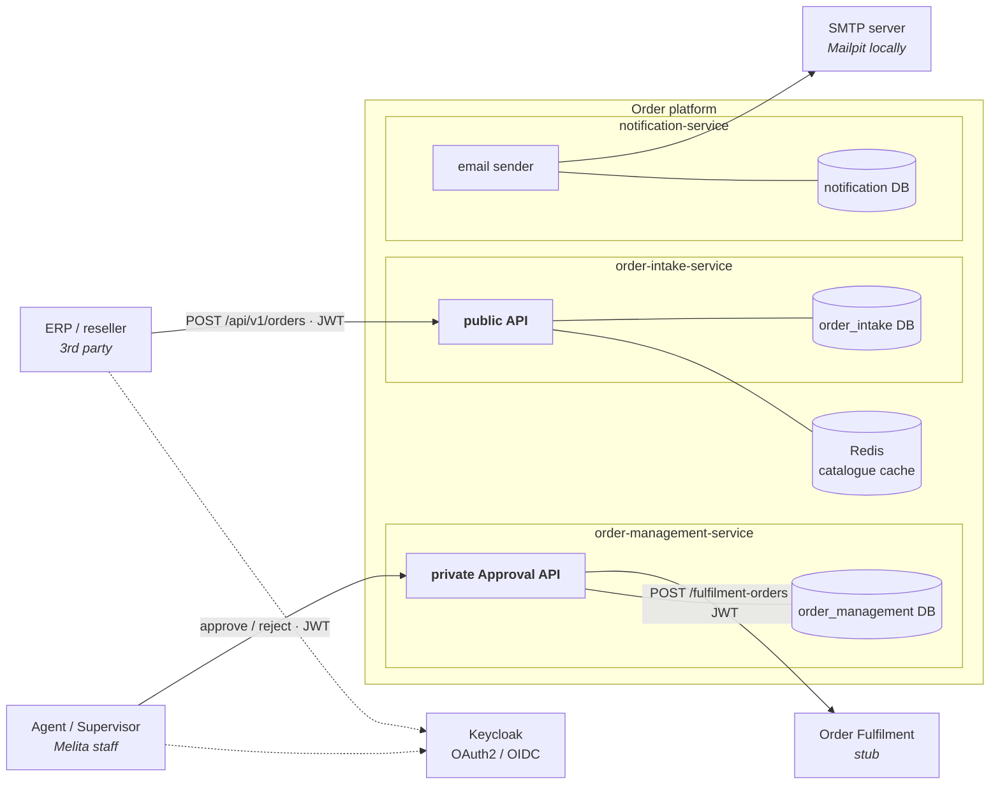
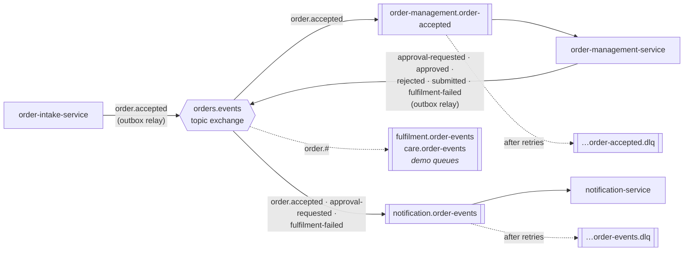
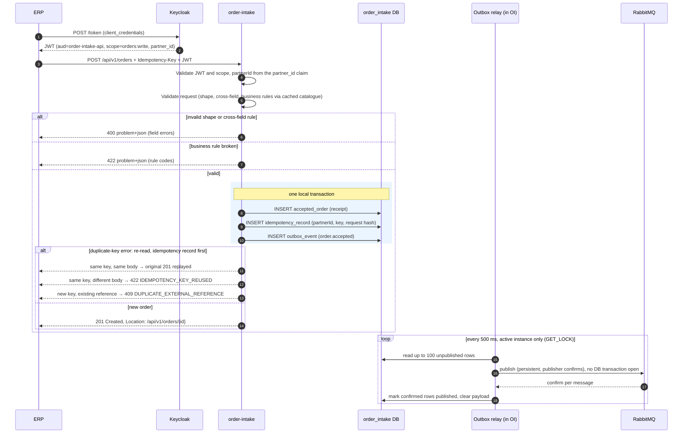
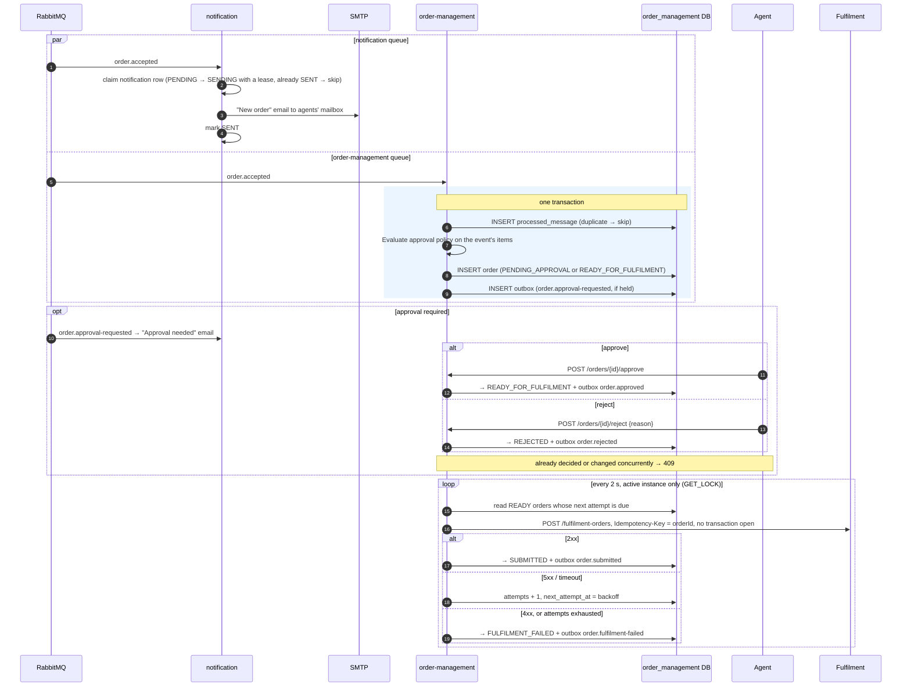
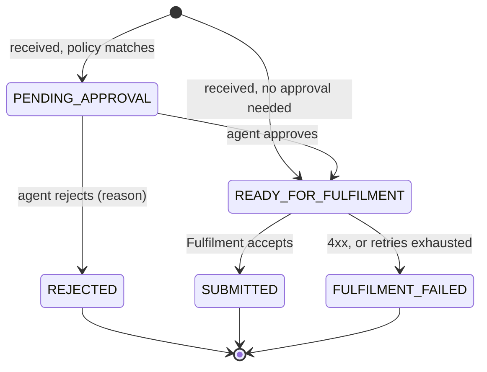

# Melita Order Taking & Approval Platform — Architecture and System Design

Status: **v1.2, matches the implementation** · Author: Supriya Thakur · Date: 2026-10-29

---

## 1. Problem statement

Third parties (for example an ERP system) sell Melita products on Melita's behalf. They need an
**authenticated public REST API** to place orders. An order carries:

- customer personal details and residential address,
- installation address, preferred installation date and time slot,
- one or more products (Internet, TV, Telephony, Mobile), each with exactly one package
  (Internet 250Mbps / 1Gbps, TV 90 / 140 channels, Telephony Free On-net / Unlimited, Mobile Prepaid / Post-paid).

The API validates and accepts the order, then publishes an event so that Melita's **Order Fulfilment** and
**Care** systems can pick it up.

Consumers of that event:

1. email the order information to an agent (SMTP),
2. persist the order in a database (Spring Data JPA),
3. submit the order RESTfully to the Order Fulfilment system,
4. hold orders containing **products that need approval** until an agent approves them through an
   **authenticated private Order Approval API**.

## 2. Assumptions

### 2.1 Non-functional targets (assumed)

| Quality | Target | Consequence for the design |
|---|---|---|
| Volume | ~5,000 orders/day, peaks of ~20 requests/s | One MySQL server and single-node RabbitMQ/Redis are enough |
| Latency | `POST /orders` p95 < 500 ms | Intake validates and runs one local transaction; no synchronous downstream calls |
| Availability | Intake keeps accepting orders while order-management, Fulfilment or SMTP are down | Asynchronous hand-off through the outbox and broker |
| Durability | An order answered with `201` is never lost | `201` only after the order and its event commit in one transaction |
| Scalability | Every service can run ≥ 2 instances | Stateless services; scheduled jobs run on one instance at a time (§10.3) |

### 2.2 Functional assumptions

| # | Assumption |
|---|---|
| A1 | Callers of the public API are B2B partners onboarded by Melita, authenticating machine-to-machine. |
| A2 | An order has 1–4 items, at most one package per product type. |
| A3 | The customer always has a residential address. **Installation details are required only if at least one product needs a technician visit** (Internet, TV, Telephony); the installation address defaults to the customer's (`useCustomerAddress: true`). A Mobile-only order has no installation block. |
| A4 | Pricing, contracts and payment are out of scope; the partner has already sold the order. |
| A5 | The preferred date and slot are a *preference*. Fulfilment owns scheduling and confirms the appointment. Intake only enforces rules: fixed slots, minimum lead time, maximum horizon, no Sundays or public holidays. |
| A6 | Customers are Maltese residents: Maltese postcode, E.164 phone, minimum age 18, and a mandatory identity document (ID card or passport), needed for telecoms KYC. |
| A7 | "Configurable products need approval" is read as: **which products/packages need approval is configurable**. The list lives in Spring Cloud Config. An admin API to manage the list is the alternative reading, listed in §16. |
| A8 | Approval is for the **whole order**. A rejection needs a reason and is final. |
| A9 | The Fulfilment REST contract is not given, so we define one (§8.3) and provide a stub. |
| A10 | The order email goes to a configurable shared agents' mailbox. |

## 3. Technology choices

| Concern | Choice |
|---|---|
| Language / runtime | Java 21, virtual threads on. Spring MVC (blocking I/O workload), no WebFlux |
| Framework | Spring Boot 4.0.9, Spring Cloud 2025.1.4 (latest stable pair) |
| Build | Maven multi-module, Maven Wrapper |
| Database | MySQL 8.4, Flyway, Spring Data JPA, `ddl-auto=validate` |
| Messaging | RabbitMQ 4 (Spring AMQP), quorum queues, publisher confirms |
| Cache | Redis (Spring Cache) |
| Identity | Keycloak 26 (realm imported on startup); services are OAuth2 resource servers |
| Email | Spring Mail + Thymeleaf; Mailpit as the local SMTP server |
| Resilience | Resilience4j circuit breaker |
| API docs | springdoc-openapi + Swagger UI |
| Tests | JUnit 5, AssertJ, Mockito, Spring Boot test slices, spring-security-test, Testcontainers, WireMock; Postman + Newman |

## 4. Architecture overview

### 4.1 Services, data stores and calls



Dotted arrows are token requests. Every service also loads its configuration from the **Config Server**
at startup.

### 4.2 Event flow



The demo queues stand in for Fulfilment and Care, which in production declare and own their own queues.
They let a reviewer see every event arrive in the RabbitMQ UI.

### 4.3 Services and responsibilities

| Service | Owns | Exposes | Consumes | Publishes |
|---|---|---|---|---|
| **config-server** | Reads `config-repo/` from git | `/{app}/{profile}` (HTTP Basic, internal) | — | — |
| **order-intake-service** | Product catalogue, order receipts, idempotency records, outbox | **Public** `/api/v1/orders`, `/api/v1/catalogue/products` | — | `order.accepted` |
| **order-management-service** | The order and its lifecycle, approvals, Fulfilment submission, outbox, inbox | **Private** `/api/v1/orders`, `/approve`, `/reject`, `/api/v1/approval-policy` | `order.accepted` | `order.approval-requested`, `order.approved`, `order.rejected`, `order.submitted`, `order.fulfilment-failed` |
| **notification-service** | Email templates, notification log | Actuator only | `order.accepted`, `order.approval-requested`, `order.fulfilment-failed` | — |
| **fulfilment-stub** | In-memory fulfilment orders | `/api/v1/fulfilment-orders` | — | — |

**Why these three business services?**
- **Intake** is the internet-facing edge. It stays small and available even when everything behind it is
  down; it makes no synchronous call to another business service.
- **Order management** is the system of record for an order's lifecycle.
- **Notification** is a separate failure domain: an SMTP outage must not affect orders.
- A modular monolith would be my default at this size. The requirement is for microservices, so the
  boundaries are drawn where a split pays off: different exposure (public vs private), different failure
  domains (SMTP), different owners of state.

**Config Server availability:** services fetch configuration at startup and keep it in memory, so an outage
blocks only new instances from starting. They fail fast if the Config Server is unreachable; compose start-up
ordering (and a restart policy in production) brings them up once it is.

### 4.4 Repository layout

```
Melita/
├── pom.xml                  (parent: dependency and plugin management)
├── order-events-contract/   (event records and routing keys only)
├── platform-common/         (error model, request-ID filter, security error handlers, outbox, inbox, PII encryption)
├── config-server/
├── order-intake-service/
├── order-management-service/
├── notification-service/
├── fulfilment-stub/
├── config-repo/             (configuration served by Config Server)
├── infra/                   (Keycloak realm, MySQL init script, RabbitMQ users/permissions setup script)
├── postman/                 (collection and environments)
├── docs/ARCHITECTURE.md
├── docker-compose.yml, .env.example
└── .github/workflows/ci.yml
```

- `platform-common` is a plain library. Services pull in what they need with explicit `@Import`, so
  nothing is configured behind their back.
- Each service keeps its own `SecurityFilterChain`. Domain code is never shared.

## 5. End-to-end flows

### 5.1 Place order



- Validation runs before the transaction, so invalid requests never hold a DB connection.
- The `201` is sent only after the commit, so an acknowledged order always has its event in the outbox.
- A message whose confirm does not arrive stays unpublished and is sent again on the next tick.
  Consumers are idempotent, so the rare duplicate is harmless.
- An event the broker accepts but no queue receives (nobody has bound that routing key yet) is still marked
  published, with a warning. Retrying it forever would eventually fill the relay's batch and block every
  other event.

### 5.2 Process order



- **Unknown outcome.** On a timeout, or a 2xx whose body cannot be read, the order is retried with the same
  `Idempotency-Key`. If the first call did reach Fulfilment, the retry gets the same `fulfilmentReference`
  back instead of creating a second order.
  - The request body must not change between attempts, so `preferredSlotExpired` is decided at the first
    attempt and stored.
- **One bad order cannot block the others.** An unexpected error while submitting one order is recorded as a
  failed attempt with backoff. The order moves back in the queue and eventually fails, instead of being
  retried first on every tick.
- **Circuit breaker.** While the breaker is open, calls fail fast and the order is left untouched, so an
  outage does not use up retry attempts.

## 6. Patterns used

| Pattern | Where | Why |
|---|---|---|
| **Transactional Outbox** + polling relay | Intake and management publish only through `outbox_event` | "Order saved ⇔ event published" without distributed transactions |
| **Idempotency Key** | Inbound `POST /orders`; outbound calls to Fulfilment | Callers retry on timeouts; retries must not create duplicates |
| **Idempotent Receiver** (inbox) | `processed_message` in management; `notification` unique key | RabbitMQ delivers at least once |
| **Publish–Subscribe** (topic exchange) | `orders.events` | Each consumer gets its own copy; new consumers don't change the producer |
| **Dead Letter Channel** | A DLQ per consumer queue | Failed messages are parked, not lost, and don't block the queue |
| **Event-Carried State Transfer** | `order.accepted` carries the full validated order | Consumers never call back to intake |
| **State Machine** | `OrderStatus` with allowed transitions | Illegal moves become a 409, never a silent overwrite |
| **Pessimistic + optimistic locking** | `SELECT … FOR UPDATE` before a decision; `@Version` on the order | Two agents deciding at once: the second waits and gets 409; no deadlock |
| **Circuit Breaker** | Fulfilment client | Stops hammering a failing Fulfilment system |
| **Cache-Aside** | Product catalogue in Redis | Read on every order, rarely changed; falls back to the DB |
| **Correlation Identifier** | `X-Request-Id` → logs → event → logs | One ID follows an order across services |

## 7. Domain model

### 7.1 Order request

```json
{
  "externalReference": "ERP-2026-000123",
  "customer": {
    "firstName": "Maria", "lastName": "Borg",
    "dateOfBirth": "1990-04-12",
    "email": "maria.borg@example.com",
    "mobileNumber": "+35679123456",
    "identityDocument": { "type": "ID_CARD", "number": "123456M" },
    "address": { "line1": "12, Triq il-Kbira", "line2": null, "locality": "Mosta", "postcode": "MST 1234" }
  },
  "installation": {
    "useCustomerAddress": true,
    "address": null,
    "preferredDate": "2026-11-09",
    "timeSlot": "MORNING"
  },
  "items": [
    { "product": "INTERNET", "packageCode": "INTERNET_1GBPS" },
    { "product": "TV", "packageCode": "TV_140_CHANNELS" },
    { "product": "MOBILE", "packageCode": "MOBILE_POSTPAID" }
  ]
}
```

| Field | Rule |
|---|---|
| `externalReference` | Required, 1–64 characters, `[A-Za-z0-9._-]`; unique per partner |
| `firstName`, `lastName` | Required, 1–100 characters; letters (including Maltese `ċ ġ ħ ż`), spaces, apostrophes, hyphens |
| `dateOfBirth` | Required, past date |
| `email` | Required, valid, ≤ 254 characters |
| `mobileNumber` | Required, E.164 (`^\+[1-9]\d{7,14}$`) |
| `identityDocument` | Required. `ID_CARD`: `^\d{1,7}[MGAPLHBZ]$`; `PASSPORT`: 6–20 alphanumerics |
| `address` | `line1`, `locality` required; `postcode` `^[A-Z]{3}\s?\d{4}$` |
| `items` | 1–4; `product` is an enum; `packageCode` is a catalogue code |

### 7.2 Validation

1. **Shape** (Bean Validation on DTO records) → **400** with field errors. Unknown JSON properties are
   rejected so a typo cannot silently drop a field.
2. **Cross-field** (class-level validators) → **400**: no duplicate product types;
   `installation.address` present ⇔ `useCustomerAddress` is false.
3. **Business rules** (domain service, using the catalogue and configured slot rules) → **422**:

   | Rule | Error code |
   |---|---|
   | Package exists and is active | `UNKNOWN_PACKAGE` |
   | Package belongs to the stated product | `PACKAGE_PRODUCT_MISMATCH` |
   | Installation present ⇔ an item needs a technician visit | `INSTALLATION_REQUIRED`, `INSTALLATION_NOT_APPLICABLE` |
   | Customer is ≥ 18 | `CUSTOMER_UNDERAGE` |
   | Date within lead time and horizon, not an excluded day, valid slot | `INSTALLATION_DATE_INVALID` |

- All violations are reported together, so a partner fixes everything in one round-trip.
- "Today" and age are computed in **Europe/Malta** from an injected `Clock`, so date rules are correct
  around midnight and deterministic in tests.

### 7.3 Order lifecycle (order-management)



- The allowed transitions live in the `OrderStatus` enum. `order.transitionTo(target, actor, reason)` is
  the only way to change status; an illegal move throws, which becomes a 409.
- Every transition writes an `order_status_history` row: who, when, why.
- A temporary Fulfilment failure keeps the order in `READY_FOR_FULFILMENT` with a later `next_attempt_at`.
- **Approval after the preferred date has passed:** approval still goes ahead and the Fulfilment request
  carries `preferredSlotExpired: true`, so Fulfilment arranges a new date with the customer. The agent
  sees a warning in the response.

### 7.4 Approval policy

```yaml
# config-repo/order-management.yml
approval:
  required-packages: [MOBILE_POSTPAID, INTERNET_1GBPS]
  required-products: []          # e.g. [TV] to require approval for any TV package
```

- It is evaluated **once, when the order is received**, against the items carried in the event. The
  matched rules are stored on the order (`approval_reasons`), so a policy change never re-classifies
  orders in flight, and the agent sees *why* an order is held.
- Changing it: commit to the config repo, then `POST /actuator/refresh` on order-management. The
  `ApprovalPolicy` bean is `@RefreshScope`, so it is rebuilt with the new values.
- `GET /api/v1/approval-policy` shows the active policy.

## 8. API design

All errors are `application/problem+json` (RFC 9457) with a stable `code` and the `requestId`. Responses
never include stack traces or internal messages.

```json
{
  "type": "https://api.melita.example/problems/validation-error",
  "title": "Request validation failed",
  "status": 400,
  "code": "VALIDATION_FAILED",
  "requestId": "6f1c…",
  "errors": [ { "field": "customer.mobileNumber", "message": "must be in E.164 format" } ]
}
```

**Conventions:**
- versioning in the URI (`/api/v1`), additive changes only within a version;
- ISO-8601 dates and UTC instants;
- pagination with `page`, `size` (max 100) and `sort`, returned as Spring Data's `PagedModel`;
- `X-Request-Id` on every response;
- OpenAPI generated from the code at `/v3/api-docs`, with Swagger UI.

### 8.1 Public Order Taking API (order-intake, port 8081)

| Method | Path | Auth | Success | Errors |
|---|---|---|---|---|
| POST | `/api/v1/orders` | scope `orders:write`; header `Idempotency-Key` required | **201** + `Location` + `{orderId, externalReference, status: ACCEPTED, acceptedAt}`; a replay returns the same 201 with `Idempotent-Replayed: true` | 400, 401, 403, 409 `DUPLICATE_EXTERNAL_REFERENCE` (with `existingOrderId`), 422 business rule, 422 `IDEMPOTENCY_KEY_REUSED` |
| GET | `/api/v1/orders/{orderId}` | scope `orders:read`, own orders only | 200 receipt | 404 (also for another partner's order, so existence is not leaked) |
| GET | `/api/v1/catalogue/products` | scope `orders:read` | 200 products and packages | 401, 403 |

### 8.2 Private Order Approval API (order-management, port 8082)

| Method | Path | Auth | Success | Errors |
|---|---|---|---|---|
| GET | `/api/v1/orders?status=PENDING_APPROVAL&page=0&size=20` | role `AGENT` | 200 page of summaries | 400, 401, 403 |
| GET | `/api/v1/orders/{id}` | `AGENT` | 200 detail (ID number masked) | 404 |
| POST | `/api/v1/orders/{id}/approve` `{ "comment": "…" }` (optional) | `AGENT` | 200 updated order, with `warnings` if the slot has expired | 404, 409 |
| POST | `/api/v1/orders/{id}/reject` `{ "reason": "…" }` (10–500 characters) | `AGENT` | 200 updated order | 400, 404, 409 |
| GET | `/api/v1/approval-policy` | `SUPERVISOR` | 200 active policy | 401, 403 |

- The deciding agent is taken from the JWT, never from the request body, and stored for audit.
- `SUPERVISOR` is a composite role that includes `AGENT`.

### 8.3 Fulfilment contract (stub, port 8084)

```
POST /api/v1/fulfilment-orders
Authorization: Bearer <client-credentials JWT, scope fulfilment:submit>
Idempotency-Key: <orderId>
{ "orderId", "externalReference", "customer", "installation" (incl. preferredSlotExpired), "items" }
```

| Response | Submitter outcome |
|---|---|
| 201 `{ "fulfilmentReference": "FUL-…" }`, or 200 replay | `SUBMITTED` |
| 400 / 401 / 403 / 409 / 422 | `FULFILMENT_FAILED`; not retried, because retrying cannot help |
| 429 / 5xx / timeout | Retried with exponential backoff, at most 5 attempts |

The stub answers any status on demand via an `X-Stub-Force-Status` request header, so failure paths are
easy to exercise from tests and Postman.

## 9. Messaging design

### 9.1 Topology

| Exchange | Queue ← routing keys |
|---|---|
| `orders.events` (topic) | `order-management.order-accepted` ← `order.accepted` |
| | `notification.order-events` ← `order.accepted`, `order.approval-requested`, `order.fulfilment-failed` |
| | demo: `fulfilment.order-events`, `care.order-events` ← `order.#` |
| `orders.events.dlx` (direct) | `<queue>.dlq` ← the queue's name |

- Consumer queues are durable **quorum queues** with `x-dead-letter-exchange` and an explicit
  `x-dead-letter-routing-key`. Without the routing key, dead-lettered messages would keep their original
  key and match no DLQ.
- Each consumer declares its own queue in code; producers declare the exchange.

### 9.2 Event envelope

```json
{
  "eventId": "8d0c…",
  "eventType": "order.accepted",
  "schemaVersion": 1,
  "occurredAt": "2026-10-29T10:15:30Z",
  "correlationId": "6f1c…",
  "data": { "orderId": "…", "partnerId": "…", "externalReference": "…", "customer": {…}, "installation": {…}, "items": [ … ] }
}
```

- Only `order.accepted` carries personal data, because Fulfilment and Care need it. The later events carry
  IDs, status and reason only.
- AMQP properties repeat the metadata (`message_id`, `type`, persistent delivery, `x-correlation-id`).
- Schema evolution: additive changes only within a version; consumers ignore unknown fields.

### 9.3 Delivery guarantees and errors

| Step | Guarantee | How |
|---|---|---|
| DB → broker | At-least-once | Outbox; a row is marked published only after the broker confirms it |
| Broker → consumer | At-least-once | Ack after the listener succeeds |
| Side effect | Once per message | Inbox row in the same transaction (management); unique `notification` row (notification) |
| Ordering | Not guaranteed | Not needed: management reacts to one event type, and notification treats each event independently |

**Consumer errors**, in two classes:
- **Poison** (unreadable or invalid payload): straight to the DLQ, since retrying cannot help.
- **Everything else:** retried in the listener 5 times with exponential backoff (2 s → 30 s, about one
  minute in total), then sent to the DLQ. The one-minute window rides out short outages such as a database
  restart without filling the DLQ.

Messages in a DLQ are inspected and moved back with the RabbitMQ management UI (runbook in the README).

**Email** is a notification, never the source of truth. An order awaiting approval is always visible in
the Approval API, whether or not its email arrived.

Only one consumer can claim an email: a conditional update moves the row from `PENDING` (or `FAILED`) to
`SENDING` with a 2-minute lease. If two copies of the same event arrive at once, the second claim fails and
that copy is skipped. A failed send releases the row for the listener's retry.

A known edge case: if notification crashes after the SMTP send but before marking the row `SENT`, the lease
expires and a redelivery sends the email again. This is accepted, since email is at-least-once by nature.

Dead-lettering logs only the message ID and type, never the body: an `order.accepted` body contains personal
data. (Spring's stock `RejectAndDontRequeueRecoverer` logs the whole message, so it is not used.)

## 10. Data design

**Database per service.** Each service owns its database (`order_intake`, `order_management`,
`notification`):
- each is accessed only through that service's DB user, whose grants cover that database alone;
- no service touches another's data. Data moves only through events and APIs.
- Locally the three databases share one MySQL server; in production they can be split by changing the
  JDBC URL only.

**Conventions:**
- `InnoDB`, `utf8mb4_unicode_ci`.
- IDs are UUIDs stored as `CHAR(36)`: generated in the application, readable in SQL and logs, and the
  same `orderId` is used across services.
- Identifiers that clients send (partner IDs, external references, idempotency keys) use binary collation:
  they are compared exactly, including case.
- Timestamps are `DATETIME(6)` in UTC, not `TIMESTAMP`, which ends in 2038.
- Enums are `VARCHAR` plus a `CHECK` constraint, so adding a value is a cheap migration.
- Flyway migrations are forward-only.

### 10.1 `order_intake`

| Table | Key columns and constraints | Indexes |
|---|---|---|
| `product` | `code` PK, `name`, `requires_installation`, `active` | — |
| `product_package` | `code` PK, `product_code` FK, `name`, `active` | FK |
| `accepted_order` | `id` PK, `partner_id`, `external_reference`, `status`, `accepted_at`; **UNIQUE(`partner_id`, `external_reference`)** | the unique key |
| `idempotency_record` | **PK(`partner_id`, `idempotency_key`)**, `request_hash`, `order_id` FK, `created_at` | `created_at` (nightly purge after 30 days) |
| `outbox_event` | `id` auto-increment PK, `event_id` UNIQUE, `event_type`, `routing_key`, `payload JSON`, `created_at`, `published_at` | `(published_at, id)` for the relay's scan |

- Intake keeps a **receipt**, not the customer's personal data. The full order travels in the outbox event,
  and the relay clears `payload` once it is published.
- **Request hash:** SHA-256 of the request re-serialised with sorted keys, so formatting differences don't
  count as a different body.
- **Duplicates:** the order, idempotency record and outbox row are inserted in one transaction. On a
  duplicate-key error the request is re-read in a new transaction, checking the idempotency record first
  (replay or 422) and then the reference (409). A retried request is therefore always replayed, never
  answered with a 409.

### 10.2 `order_management` and `notification`

| Table | Key columns and constraints | Indexes |
|---|---|---|
| `customer_order` | `id` PK (= intake orderId), `partner_id`, `external_reference`, `status` (CHECK), embedded customer and address, installation (nullable), `preferred_slot_expired` (fixed at the first submission), `id_document_number` (**encrypted**), `approval_reasons` (comma-separated codes), `decided_by`, `decided_at`, `decision_note`, `fulfilment_reference`, `attempts`, `next_attempt_at`, `last_error`, `version`, `received_at`, `updated_at` | `(status, received_at)` for the pending list; `(status, next_attempt_at)` for the submitter |
| `order_item` | `id` PK, `order_id` FK, `product_code`, `package_code`, `package_name`; UNIQUE(`order_id`, `product_code`) | FK |
| `order_status_history` | `id` PK, `order_id` FK, `from_status`, `to_status`, `actor`, `reason`, `occurred_at` | `(order_id, occurred_at)` |
| `processed_message` | **PK(`message_id`)**, `processed_at` | — |
| `outbox_event` | as in intake | as in intake |
| `notification` *(notification DB)* | `id` PK, `event_id`, `template`, `order_id`, `recipient`, `status` (`PENDING`/`SENDING`/`SENT`/`FAILED`), `claimed_until` (lease), `attempts`, `last_error`, `created_at`, `sent_at`; **UNIQUE(`event_id`, `template`)** | the unique key is the dedupe |

- **ID document number:** encrypted with AES-256-GCM by a JPA `AttributeConverter`, with the key from the
  environment. Stored as `v1:<base64>`; the prefix leaves room for key rotation. It is masked (`****56M`)
  in the API and emails, and never logged.
- **N+1:** the list endpoint uses a projection without items; the detail endpoint loads items with
  `@EntityGraph`.

### 10.3 Transactions and concurrency

- **No remote call inside a DB transaction:** no HTTP, SMTP or broker publish.
- Correctness comes from constraints, `@Version` and the state machine, not from the isolation level.

| Scenario | Outcome | Mechanism |
|---|---|---|
| Same `Idempotency-Key` sent twice in parallel | One order; the second request gets the first response | The second insert waits on the unique key, fails, and is re-read and replayed |
| Two agents decide the same order at once | One wins; the other gets 409 | The decision reads the order with `SELECT … FOR UPDATE`; the second waits, then the state machine rejects it. `@Version` stays as a safety net. Without the row lock, MySQL deadlocks: each status-history insert takes a shared lock on the order row (foreign key check) before each update needs an exclusive one |
| Same event delivered twice | One order, one email | Inbox primary key; `notification` unique key plus an atomic lease claim, so two copies processed at once send one email |
| Submitter finishes after an agent changed the order | Agents cannot change a READY order; the submitter's update also locks the row and is guarded by `@Version` | Row lock + optimistic locking |

**Scheduled jobs run on one instance at a time.** The outbox relay and the Fulfilment submitter run on
every instance, but each tick first takes a MySQL named lock: `GET_LOCK('outbox-relay', 0)` or
`GET_LOCK('fulfilment-submitter', 0)`. Only the instance holding the lock works; the others skip the tick.
- The lock belongs to the **database connection**, so the job holds one connection for the whole tick and
  releases the lock on that same connection. It holds no transaction while calling RabbitMQ or Fulfilment.
- If the active instance dies, its connection closes and MySQL frees the lock immediately; another
  instance takes over on its next tick.
- If two instances ever overlap, the worst case is a duplicate publish or a duplicate Fulfilment call.
  Both are harmless: consumers are idempotent, and Fulfilment dedupes by `Idempotency-Key`. The lock saves
  work; correctness does not depend on it.

## 11. Security design

### 11.1 Identity (Keycloak realm `melita`)

| Client / user | Flow | Token |
|---|---|---|
| `erp-partner`, `other-partner` | client credentials | `aud=order-intake-api`, `scope=orders:write orders:read`, `partner_id` claim |
| `order-management` | client credentials | `aud=fulfilment-api`, `scope=fulfilment:submit` |
| `agent-console` (**local realm only**) | password grant for the test users | `aud=order-management-api`, roles `AGENT` / `SUPERVISOR` |
| users `agent1`, `supervisor1` | — | `SUPERVISOR` includes `AGENT` |

- **Partner identity** comes from a dedicated `partner_id` claim, not from the OAuth client ID, so a
  partner can rotate or add clients without losing its orders.
- In production, agents sign in through a UI with authorisation code + PKCE; the password grant exists in
  the local realm only, so Postman and CI can obtain agent tokens.
- Access tokens live 5 minutes. No real secrets are committed; they come from `.env`.

### 11.2 Resource servers

- A stateless `SecurityFilterChain` per service. CSRF is disabled **because** there are no cookies or
  sessions.
- JWTs are validated against Keycloak's keys, including issuer, expiry and **audience**
  (`spring.security.oauth2.resourceserver.jwt.audiences`), so a token issued for another API is rejected.
- Authorisation is deny-by-default URL rules plus `@PreAuthorize` on service methods.
- **Partner isolation:** every intake query is scoped by the token's `partnerId`. Another partner's
  order → 404.
- 401 and 403 are returned as problem JSON.
- Actuator: only `health` and `info` are public; the rest needs authentication.
- Fulfilment calls use Spring Security's OAuth2 client (client credentials), which caches and renews the
  token.
- **Least privilege:**
  - a DB user per service;
  - a RabbitMQ user per service, limited to its exchange and queues;
  - Redis behind a password;
  - only the APIs, Keycloak and the Mailpit and RabbitMQ UIs are published by compose.
- **No personal data in logs:** only `orderId`, `externalReference` and `partnerId` are logged.
- The private API is private by deployment too: in production it sits on the internal network only.

### 11.3 Threats

| Threat | Mitigation |
|---|---|
| Stolen or misused token | Short-lived JWTs, audience check, scopes and roles, deny by default |
| Partner reading another partner's orders | Partner scoping on every query; 404 |
| Duplicate submission | Idempotency key and external-reference uniqueness |
| Forged approval identity | Agent taken from the JWT only; status history audit |
| Information disclosure in errors | Problem JSON with stable codes; generic 500 with `requestId` |
| Personal data exposure | ID number encrypted and masked; intake keeps no personal data; least-privilege DB users; TLS and storage encryption in production |
| Flooding the public API | Request size and item limits; rate limiting per partner at an API gateway in production |

## 12. Caching

| Data | Cached? | Why |
|---|---|---|
| Product catalogue | **Yes**: Redis, one entry, TTL 10 minutes, evicted on startup | Read on every order, changes only with a release |
| Approval policy, slot rules | No | Already in memory from config |
| Orders and approval state | **No** | Change often and are updated concurrently; a stale read would cause wrong decisions |
| Idempotency | No (MySQL) | Must commit atomically with the order |

Redis is optional. If it is down or slow (200 ms timeout), a `CacheErrorHandler` logs the error and the
catalogue is read from MySQL.

## 13. Configuration (Spring Cloud Config)

- Config Server uses the **git backend**, reading `config-repo/` from this repository. Configuration is
  versioned and every change is auditable.
  - It **clones** the repository into its own directory (the URI is a plain path, not `file:`). A `file:`
    URI would make it check out branches in the working tree it reads from.
  - It serves committed changes only, from the label `CONFIG_GIT_LABEL` (default `main`; CI uses the commit
    under test).
- Files: `application.yml` (shared), `<service>.yml`, and `<service>-docker.yml` (container host names).
- Each service has only `spring.application.name` and `spring.config.import=configserver:…` locally, and
  fails fast if the Config Server is unreachable. Config Server access uses HTTP Basic credentials from the
  environment.
- Typed `@ConfigurationProperties` records with `@Validated`, so bad config fails at startup.
- Secrets are `${ENV_VAR}` placeholders resolved from the environment (`.env`, never committed).
- Tests run without Config Server (`spring.cloud.config.enabled=false`).

## 14. Observability

- JSON structured logs (Spring Boot's ECS format) with `requestId` and `orderId`.
- `X-Request-Id` is accepted or generated at the edge, returned on the response, carried in events as
  `correlationId`, and put back into the logs by consumers.
- Actuator health with liveness and readiness probes (DB and RabbitMQ).
- One custom metric, `outbox.pending`, the backlog of unpublished events.

## 15. Testing strategy

| Level | Proves |
|---|---|
| **Unit** (JUnit 5, fixed `Clock`) | Every validation and business rule, including dates at Malta midnight; every state transition, valid and invalid; approval policy matching; request-hash canonicalisation; ID-number encryption and masking |
| **Web slice** (`@WebMvcTest` + `jwt()`) | Error responses (400/422 shapes); the security matrix: 401/403 per endpoint, scope and role, and 404 for another partner's order |
| **Integration** (`@SpringBootTest` + Testcontainers MySQL, RabbitMQ, Redis, Mailpit; WireMock for Fulfilment) | Order → outbox → RabbitMQ; **parallel duplicate Idempotency-Key**; replay, 422 and 409 cases; **duplicate event delivery**; **concurrent approve vs reject**; poison message → DLQ; Fulfilment 201 / 5xx-then-201 / 4xx; email content via Mailpit; Redis down → catalogue from DB |
| **Postman + Newman** (against `docker compose up`) | Real Keycloak tokens; happy path to `SUBMITTED`; validation and auth failures; idempotent replay; approval and rejection; email received |

- Repositories and constraints are tested through the services, against real MySQL; there is no separate
  `@DataJpaTest` layer.
- Every commit carries its tests. CI runs `./mvnw verify`, then brings the stack up and runs Newman.

## 16. Scope

| In this release | Production roadmap (README) |
|---|---|
| Config Server, three services, the Fulfilment stub, and a compose stack | Separate config repo; secrets in Vault; Kubernetes |
| Public API: validation, idempotency, outbox, catalogue cache | API gateway with mTLS and per-partner rate limiting; partner webhooks and live order status |
| Order processing: inbox, retries, DLQs, approval API, Fulfilment submitter with breaker | Supervisor retry for failed fulfilments; admin API for approval rules (alternative reading of A7); four-eyes approval |
| Email notifications with a notification log | Bounce processing; approval reminders |
| Unit, web-slice and integration tests; Postman + Newman; CI | Distributed tracing, dashboards and alerts (DLQ depth, outbox lag, failed fulfilments) |

## 17. Key decisions

| Decision | Rejected | Reason |
|---|---|---|
| RabbitMQ topic exchange | Kafka | Fan-out to several consumers with per-queue dead-lettering fits; volume is modest; event replay is not required |
| Keycloak + JWT resource servers | Own authorisation server; API keys | Standard OAuth2 flows for machines and people; no home-grown identity provider |
| Three business services | Two (email inside management); four (separate approval service) | Separates the public edge, the order lifecycle and email delivery without a saga |
| Transactional outbox, single active relay (MySQL named lock) | Publish after commit; ShedLock; Debezium CDC | Atomic with no extra infrastructure; immediate failover; CDC is the production upgrade |
| Idempotency in MySQL | Redis `SET NX` | Same transaction as the order: no stuck keys after a crash, no duplicates if Redis loses data |
| Approval policy in Spring Cloud Config, whole-order approval | Flags in the catalogue; per-item approval | Approval rules change without a release; no partially installed orders |
